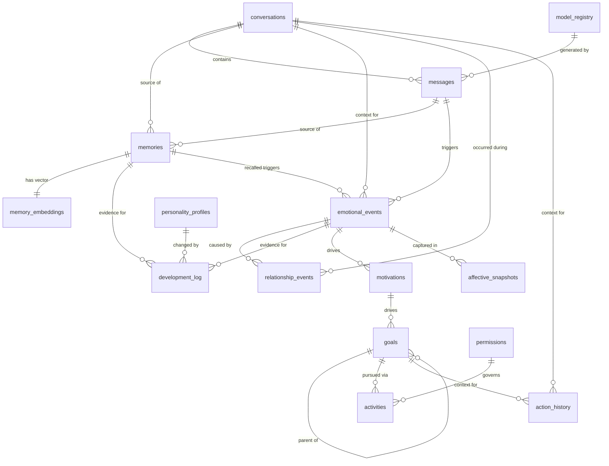
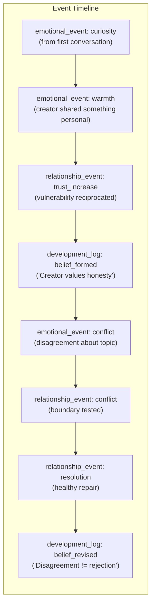
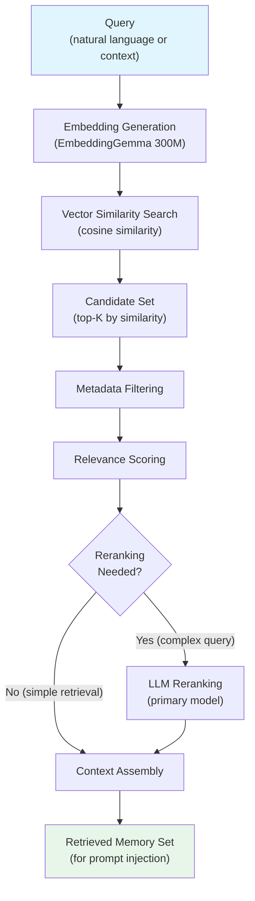
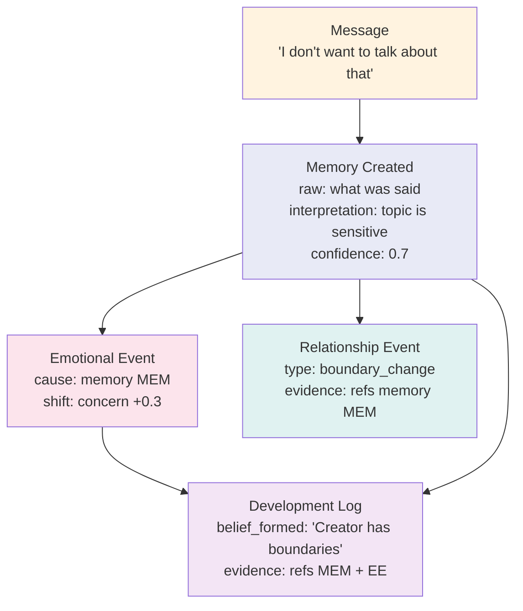

# Data and Memory Architecture

> **Document Status**: Proposed Architecture  
> **Scope**: Complete data model, memory system, and persistence strategy for Arletex/Arle  
> **Hardware Context**: ASUS ROG Ally X, 24GB shared memory, SQLite initially, single developer

---

## 1. Conceptual Entities

Every persistent entity in Arletex falls into one of four domains: **interaction history**, **psychological state**, **autonomy/action**, and **infrastructure**. The following table enumerates all entities, their domain, and their mutability semantics.

| Entity | Domain | Mutability | Purpose |
|---|---|---|---|
| `conversations` | Interaction | Mutable (metadata) | Chat sessions with lifecycle state |
| `messages` | Interaction | Append-only | Individual messages within conversations |
| `memories` | Psychological | Soft-mutable¹ | Core memory store — what Arle remembers |
| `memory_embeddings` | Psychological | Replace-on-update | Vector representations for semantic retrieval |
| `emotional_events` | Psychological | Append-only | Record of every emotional state transition |
| `affective_snapshots` | Psychological | Append-only | Periodic full-state captures of affective system |
| `personality_profiles` | Psychological | Append-only | Versioned personality state history |
| `relationship_events` | Psychological | Append-only | Trust, attachment, conflict, boundary changes |
| `development_log` | Psychological | Append-only | Evidence-backed personality/belief/preference changes |
| `preferences` | Psychological | Soft-mutable¹ | Learned preferences (topics, activities, styles) |
| `motivations` | Autonomy | Mutable (status) | Active and completed internal drives |
| `goals` | Autonomy | Mutable (status) | Structured goal records for autonomy system |
| `activities` | Autonomy | Append-only | Records of autonomous actions taken |
| `permissions` | Autonomy | Mutable | Permission policies for action types |
| `action_history` | Autonomy | Append-only | Audit trail of all significant system actions |
| `model_registry` | Infrastructure | Mutable | Registered models with roles and status |

> ¹ **Soft-mutable**: The record can be updated (e.g., marking a memory as corrected or a preference as revised), but original content is preserved. See [Section 8: Retention and Correction Policies](#8-retention-and-correction-policies).

### 1.1 Entity Details

#### conversations
| Field | Type | Description |
|---|---|---|
| `id` | TEXT (UUID) | Primary key |
| `title` | TEXT | Optional display title, may be auto-generated |
| `started_at` | INTEGER | Unix epoch ms — when session began |
| `ended_at` | INTEGER | Null if active |
| `summary` | TEXT | Post-session summary for long-term reference |
| `participant_id` | TEXT | Who Arle is talking to (initially just the creator) |
| `metadata` | TEXT (JSON) | Extensible metadata (platform, channel, etc.) |

#### messages
| Field | Type | Description |
|---|---|---|
| `id` | TEXT (UUID) | Primary key |
| `conversation_id` | TEXT | FK → conversations |
| `role` | TEXT | `user`, `assistant`, `system`, `tool` |
| `content` | TEXT | Message content |
| `created_at` | INTEGER | Unix epoch ms |
| `token_count` | INTEGER | Token count for context budget tracking |
| `model_id` | TEXT | Which model generated this (null for user messages) |
| `metadata` | TEXT (JSON) | Tool calls, attachments, processing flags |

#### memories
| Field | Type | Description |
|---|---|---|
| `id` | TEXT (UUID) | Primary key |
| `type` | TEXT | `autobiographical`, `semantic`, `procedural`, `relationship`, `developmental` |
| `content` | TEXT | The memory itself — natural language |
| `raw_observation` | TEXT | What was actually observed (before interpretation) |
| `interpretation` | TEXT | What Arle concluded from the observation |
| `confidence` | REAL | 0.0–1.0 — how confident she is in the interpretation |
| `importance` | REAL | 0.0–1.0 — significance score |
| `source_conversation_id` | TEXT | FK → conversations (nullable) |
| `source_message_id` | TEXT | FK → messages (nullable) |
| `source_event_type` | TEXT | What kind of event created this memory |
| `created_at` | INTEGER | Unix epoch ms |
| `last_accessed_at` | INTEGER | For recency-weighted retrieval |
| `access_count` | INTEGER | Times recalled — reinforces importance |
| `is_corrected` | INTEGER | 0/1 — whether this has been revised |
| `correction_reason` | TEXT | Why it was corrected |
| `corrected_at` | INTEGER | When corrected |
| `is_deleted` | INTEGER | 0/1 — soft delete flag |
| `deleted_at` | INTEGER | When soft-deleted |
| `deleted_by` | TEXT | `creator` or `arle` |
| `tags` | TEXT (JSON) | Freeform tags for categorization |
| `metadata` | TEXT (JSON) | Extensible — consolidation info, linked memories |

#### memory_embeddings
| Field | Type | Description |
|---|---|---|
| `memory_id` | TEXT | FK → memories (PK) |
| `embedding` | BLOB | 768 × float32 = 3,072 bytes per vector |
| `dimension` | INTEGER | 768 (or truncated: 256, 512) |
| `model_version` | TEXT | EmbeddingGemma version used |
| `created_at` | INTEGER | Unix epoch ms |

> [!NOTE]
> EmbeddingGemma 300M produces 768-dimensional embeddings natively. It supports Matryoshka truncation to 512, 256, or 128 dimensions with re-normalization. Start with 768 for maximum fidelity; consider truncating to 256 only if storage or search latency becomes a concern (unlikely at <10K memories).

#### emotional_events
| Field | Type | Description |
|---|---|---|
| `id` | TEXT (UUID) | Primary key |
| `timestamp` | INTEGER | Unix epoch ms |
| `cause_type` | TEXT | `message`, `memory_recall`, `goal_outcome`, `reflection`, `time_passage` |
| `cause_id` | TEXT | FK to the triggering entity (message, memory, goal, etc.) |
| `cause_description` | TEXT | Human-readable description of what caused this |
| `previous_state` | TEXT (JSON) | Full emotional state before transition |
| `new_state` | TEXT (JSON) | Full emotional state after transition |
| `dimensions_changed` | TEXT (JSON) | Which specific dimensions shifted and by how much |
| `intensity` | REAL | 0.0–1.0 — magnitude of the emotional shift |
| `confidence` | REAL | 0.0–1.0 — how certain the system is about this classification |
| `appraisal_reasoning` | TEXT | Why this event was interpreted this way |
| `conversation_id` | TEXT | FK → conversations (nullable) |

#### affective_snapshots
| Field | Type | Description |
|---|---|---|
| `id` | TEXT (UUID) | Primary key |
| `timestamp` | INTEGER | Unix epoch ms |
| `mood_state` | TEXT (JSON) | Complete current mood vector |
| `emotional_baseline` | TEXT (JSON) | Current baseline emotional tendencies |
| `active_emotions` | TEXT (JSON) | Transient emotions and their decay curves |
| `trigger_type` | TEXT | `periodic`, `significant_event`, `session_boundary` |
| `metadata` | TEXT (JSON) | Extensible |

#### personality_profiles
| Field | Type | Description |
|---|---|---|
| `id` | TEXT (UUID) | Primary key |
| `version` | INTEGER | Monotonically increasing version number |
| `created_at` | INTEGER | Unix epoch ms |
| `temperament` | TEXT (JSON) | Stable temperamental traits with current values |
| `values` | TEXT (JSON) | Core values and their relative weights |
| `beliefs` | TEXT (JSON) | Active beliefs about self, world, relationships |
| `behavioral_tendencies` | TEXT (JSON) | Typical behavioral patterns and thresholds |
| `communication_style` | TEXT (JSON) | How Arle tends to express herself |
| `change_summary` | TEXT | What changed from previous version and why |
| `triggering_event_ids` | TEXT (JSON) | References to events that caused this version |

#### relationship_events
| Field | Type | Description |
|---|---|---|
| `id` | TEXT (UUID) | Primary key |
| `timestamp` | INTEGER | Unix epoch ms |
| `participant_id` | TEXT | Who this is about |
| `event_type` | TEXT | `trust_change`, `attachment_milestone`, `conflict`, `resolution`, `boundary_change`, `repair` |
| `description` | TEXT | What happened |
| `trust_delta` | REAL | Change in trust score |
| `previous_trust` | REAL | Trust level before |
| `new_trust` | REAL | Trust level after |
| `evidence` | TEXT | What observations support this assessment |
| `conversation_id` | TEXT | FK → conversations (nullable) |
| `emotional_event_id` | TEXT | FK → emotional_events (nullable) |
| `metadata` | TEXT (JSON) | Extensible |

#### motivations
| Field | Type | Description |
|---|---|---|
| `id` | TEXT (UUID) | Primary key |
| `content` | TEXT | What the motivation is |
| `origin` | TEXT | `intrinsic`, `assigned`, `emergent`, `social` |
| `priority` | REAL | 0.0–1.0 |
| `status` | TEXT | `active`, `completed`, `abandoned`, `blocked` |
| `created_at` | INTEGER | Unix epoch ms |
| `resolved_at` | INTEGER | Nullable |
| `outcome` | TEXT | What happened |
| `emotional_event_id` | TEXT | FK → emotional_events (nullable) — what feeling drove this |
| `metadata` | TEXT (JSON) | Extensible |

#### goals
| Field | Type | Description |
|---|---|---|
| `id` | TEXT (UUID) | Primary key |
| `motivation_id` | TEXT | FK → motivations (nullable — not all goals come from tracked motivations) |
| `title` | TEXT | Short description |
| `description` | TEXT | Detailed goal specification |
| `priority` | REAL | 0.0–1.0 |
| `status` | TEXT | `planned`, `active`, `completed`, `failed`, `abandoned` |
| `requires_permission` | INTEGER | 0/1 — does this need approval |
| `permission_status` | TEXT | `pending`, `approved`, `denied`, `not_required` |
| `created_at` | INTEGER | Unix epoch ms |
| `started_at` | INTEGER | Nullable |
| `completed_at` | INTEGER | Nullable |
| `outcome` | TEXT | What happened |
| `parent_goal_id` | TEXT | FK → goals (nullable — for sub-goals) |
| `metadata` | TEXT (JSON) | Extensible |

#### activities
| Field | Type | Description |
|---|---|---|
| `id` | TEXT (UUID) | Primary key |
| `goal_id` | TEXT | FK → goals (nullable) |
| `action_type` | TEXT | What kind of action (e.g., `web_search`, `file_read`, `reflection`, `creative_writing`) |
| `description` | TEXT | What was done |
| `reason` | TEXT | Why it was done |
| `outcome` | TEXT | What resulted |
| `started_at` | INTEGER | Unix epoch ms |
| `completed_at` | INTEGER | Nullable |
| `permission_status` | TEXT | `approved`, `auto_permitted`, `denied` |
| `metadata` | TEXT (JSON) | Extensible |

#### permissions
| Field | Type | Description |
|---|---|---|
| `id` | TEXT (UUID) | Primary key |
| `action_type` | TEXT | Category of action this policy governs |
| `policy` | TEXT | `allowed`, `restricted`, `requires_approval` |
| `scope` | TEXT (JSON) | Conditions/constraints on this permission |
| `granted_by` | TEXT | Who established this policy |
| `created_at` | INTEGER | Unix epoch ms |
| `updated_at` | INTEGER | Unix epoch ms |
| `reason` | TEXT | Why this policy exists |

#### action_history
| Field | Type | Description |
|---|---|---|
| `id` | TEXT (UUID) | Primary key |
| `timestamp` | INTEGER | Unix epoch ms |
| `action_type` | TEXT | Categorization of the action |
| `actor` | TEXT | `arle`, `system`, `creator` |
| `description` | TEXT | What was done |
| `target` | TEXT | What was acted upon |
| `result` | TEXT | Outcome |
| `conversation_id` | TEXT | FK → conversations (nullable) |
| `goal_id` | TEXT | FK → goals (nullable) |
| `metadata` | TEXT (JSON) | Extensible |

#### model_registry
| Field | Type | Description |
|---|---|---|
| `id` | TEXT (UUID) | Primary key |
| `name` | TEXT | Human-readable name (e.g., `qwen3.5-9b-heretic`) |
| `role` | TEXT | `primary_llm`, `vision`, `embedding`, `tts`, `stt`, `ocr` |
| `file_path` | TEXT | Path to GGUF or model directory |
| `parameters` | TEXT (JSON) | Model-specific parameters (context size, quantization, etc.) |
| `status` | TEXT | `available`, `active`, `loading`, `error`, `deprecated` |
| `benchmark_results` | TEXT (JSON) | Performance measurements |
| `added_at` | INTEGER | Unix epoch ms |
| `last_used_at` | INTEGER | Unix epoch ms |
| `metadata` | TEXT (JSON) | Extensible |

#### development_log
| Field | Type | Description |
|---|---|---|
| `id` | TEXT (UUID) | Primary key |
| `timestamp` | INTEGER | Unix epoch ms |
| `change_type` | TEXT | `belief_formed`, `belief_revised`, `value_shift`, `preference_learned`, `preference_revised`, `personality_drift`, `skill_acquired` |
| `domain` | TEXT | What area of Arle's psychology changed |
| `previous_state` | TEXT | What she thought/felt/preferred before |
| `new_state` | TEXT | What she thinks/feels/prefers now |
| `evidence` | TEXT | What observations or experiences led to this change |
| `reasoning` | TEXT | Why this change is justified |
| `emotional_event_ids` | TEXT (JSON) | Array of FK → emotional_events |
| `memory_ids` | TEXT (JSON) | Array of FK → memories |
| `confidence` | REAL | 0.0–1.0 |
| `metadata` | TEXT (JSON) | Extensible |

#### preferences
| Field | Type | Description |
|---|---|---|
| `id` | TEXT (UUID) | Primary key |
| `category` | TEXT | `topic`, `activity`, `communication_style`, `aesthetic`, `interaction_pattern` |
| `key` | TEXT | Specific preference identifier |
| `value` | TEXT (JSON) | Preference value (can be structured) |
| `strength` | REAL | 0.0–1.0 — how strongly held |
| `evidence_count` | INTEGER | How many observations support this preference |
| `first_observed_at` | INTEGER | Unix epoch ms |
| `last_reinforced_at` | INTEGER | Unix epoch ms |
| `is_revised` | INTEGER | 0/1 |
| `revision_reason` | TEXT | If revised, why |
| `metadata` | TEXT (JSON) | Extensible |

---

## 2. Entity Relationships



### Key Relationship Semantics

- **Memories → Messages/Conversations**: Every memory records its creation context. A memory formed from a conversation stores both `source_conversation_id` and `source_message_id`. Memories from reflection or consolidation may reference other memories instead (via `metadata.source_memory_ids`).

- **Emotional Events → Triggering Entities**: The `cause_type` + `cause_id` pair on `emotional_events` is a polymorphic reference. The cause could be a message, a recalled memory, a goal outcome, or a time-passage event. The `cause_description` field provides a human-readable fallback so the event remains interpretable even if the referenced entity is unavailable.

- **Development Log → Evidence Chain**: Each development log entry references the specific emotional events and memories that served as evidence for the change. This creates a full provenance chain: `message → emotional_event → development_log → personality_profile`.

- **Relationship Events → Conversations + Emotional Events**: Relationship changes are grounded in both what happened (conversation) and how it felt (emotional event). This ensures relationship dynamics are always causally explainable.

- **Goals → Motivations → Emotional Events**: Goals trace back through motivations to the emotional states that drove them, creating a clear chain from feeling to intention to action.

---

## 3. Persistence Boundaries

### 3.1 SQLite (All Persistent State — Initial Phase)

Everything listed in Section 1 lives in a single SQLite database file. This is deliberate:

- **Single-file backup**: Copy one `.db` file to back up Arle's entire mind
- **No server process**: No PostgreSQL daemon consuming shared memory
- **ACID guarantees**: SQLite provides full transactional integrity
- **Sufficient scale**: SQLite comfortably handles millions of rows and databases up to 281 TB

The database file lives at a configurable path, defaulting to `~/.arletex/arle.db`. WAL mode is enabled for concurrent read access from the Express API while writes are serialized.

```typescript
// Conceptual configuration — not implementation code
interface DatabaseConfig {
  path: string;           // Default: ~/.arletex/arle.db
  walMode: true;          // Always WAL for read concurrency
  busyTimeout: 5000;      // ms to wait on write lock
  journalSizeLimit: number; // Limit WAL file growth
}
```

### 3.2 In-Memory Only (Runtime State)

These data structures exist only in the Node.js process and are reconstructed on startup from persisted state:

| Data | Lifetime | Reconstruction Source |
|---|---|---|
| Current inference context (token buffer) | Per-request | Built fresh from conversation history + retrieved memories |
| Active SSE connections | Per-connection | Client reconnects |
| Current affective state | Process lifetime | Latest `affective_snapshot` + replay of recent `emotional_events` |
| Current personality profile | Process lifetime | Latest `personality_profiles` row |
| LRU cache of recent embeddings | Process lifetime | Recomputed or loaded from `memory_embeddings` |
| Permission policy cache | Process lifetime | Loaded from `permissions` table |
| Model status/health | Process lifetime | Loaded from `model_registry` + runtime probing |

> [!IMPORTANT]
> The current affective state is **derived**, not stored live. On startup, the system loads the most recent `affective_snapshot` and replays any `emotional_events` that occurred after it. This means an unclean shutdown loses at most the in-flight emotional processing — the snapshot interval determines the replay window.

### 3.3 Future Migration Path: PostgreSQL + pgvector

When any of these conditions are met, migrate `memory_embeddings` (and potentially the full database) to PostgreSQL with pgvector:

1. Memory count exceeds ~50K (brute-force cosine similarity becomes noticeably slow)
2. Concurrent multi-user access is needed (Arle interacts with multiple people)
3. Advanced vector indexing features are needed (HNSW, IVFFlat)

**Migration strategy**: The application layer uses a `MemoryStore` interface that abstracts the backing store. The initial SQLite implementation can be swapped for a PostgreSQL implementation without changing any calling code.

```typescript
// Conceptual interface — the seam for future migration
interface MemoryStore {
  storeMemory(memory: Memory, embedding: Float32Array): Promise<void>;
  searchSimilar(queryEmbedding: Float32Array, opts: SearchOptions): Promise<ScoredMemory[]>;
  getMemory(id: string): Promise<Memory | null>;
  softDelete(id: string, deletedBy: string): Promise<void>;
  correctMemory(id: string, correction: MemoryCorrection): Promise<void>;
}
```

### 3.4 Vector Search Strategy (SQLite Phase)

There are three viable approaches for vector similarity search in SQLite. The recommended approach is **Option B** initially, with a path to **Option A** when needed.

| Option | Mechanism | Pros | Cons |
|---|---|---|---|
| **A. sqlite-vec** | Zero-dependency C extension using `vec0` virtual tables | Native SQL integration, SIMD-accelerated, cosine/L2/hamming, `npm install sqlite-vec` | Requires loading native extension; adds a build dependency |
| **B. Application-level brute-force** | Load all embeddings into a typed array, compute cosine similarity in JS/TS | Zero dependencies, trivially debuggable, full control over ranking | O(n) per query; loads all vectors into memory |
| **C. Separate FAISS/Hnswlib index** | Maintain an external index file alongside SQLite | Fast ANN search at scale | Two sources of truth; sync complexity; native dependency |

**Recommended phased approach:**

1. **Phase 1 (0–10K memories)**: Application-level brute-force. Load all 768-dim embeddings into a `Float32Array` on startup (~30MB at 10K memories — trivial for 24GB system). Compute cosine similarity in TypeScript. Latency for 10K vectors: <10ms on modern hardware.

2. **Phase 2 (10K–50K memories)**: Integrate `sqlite-vec` via `npm install sqlite-vec`. Create a `vec0` virtual table mirroring `memory_embeddings`. Use SQL-native `MATCH` queries. Still a single-file database.

3. **Phase 3 (50K+ memories)**: Migrate to PostgreSQL + pgvector with HNSW indexing. This is years away for a single-user system generating perhaps 10–50 memories per day.

> [!TIP]
> At Phase 1 scale, the brute-force approach has a hidden advantage: you can apply complex metadata filters (type, recency, importance thresholds) *before* computing cosine similarity, reducing the search space. Vector index approaches typically require post-filtering.

---

## 4. Event History (Append-Only)

### 4.1 Append-Only Tables

Four tables form the immutable historical record of Arle's psychological development:

| Table | Records | Why Append-Only |
|---|---|---|
| `emotional_events` | Every emotional state transition | Emotional history cannot be retroactively changed — she felt what she felt |
| `relationship_events` | Every relationship milestone/change | Trust history must be auditable and traceable |
| `development_log` | Every personality/belief/preference change | The "why" of who she became must be preserved |
| `action_history` | Every significant action taken | Accountability and learning from past actions |

These tables have no `UPDATE` or `DELETE` operations in the application layer. The only mutation is `INSERT`.

### 4.2 Reconstructing Developmental History

The append-only event history enables a powerful capability: **replaying Arle's psychological development** to understand how she arrived at her current state.



Given any current belief, value, or personality trait, the system can trace backward through the `development_log` to find:
1. **What changed**: The `previous_state` → `new_state` delta
2. **What caused it**: The referenced `emotional_event_ids` and `memory_ids`
3. **What was observed**: The `raw_observation` on the source memories
4. **What was interpreted**: The `interpretation` and `confidence` on those memories
5. **What was felt**: The emotional transitions in the linked emotional events

This chain makes Arle's development **transparent and debuggable** — both for the developer and, eventually, for Arle herself when she reflects on her own growth.

### 4.3 Snapshot Strategy

Since replaying the entire event history from the beginning would be expensive, `affective_snapshots` serve as checkpoints:

- **Periodic snapshots**: Every N minutes of active interaction (proposed: every 15 minutes)
- **Event-driven snapshots**: After any emotional event with intensity > 0.7
- **Session boundary snapshots**: At conversation start and end

To reconstruct the current affective state: load the most recent snapshot, then replay all `emotional_events` with `timestamp > snapshot.timestamp`.

---

## 5. Memory Retrieval Pipeline

### 5.1 Pipeline Overview



### 5.2 Stage Details

#### Stage 1: Embedding Generation
- Input: The retrieval query (often the user's latest message, sometimes a system-generated reflection prompt)
- Model: EmbeddingGemma 300M (768-dim output, 2048 token context window)
- Output: `Float32Array[768]` — the query embedding
- Latency target: <100ms (this is a 300M parameter model on shared GPU; should be fast)

> [!NOTE]
> EmbeddingGemma can run concurrently with the primary LLM since it is small enough to fit alongside the 9B model in 24GB shared memory. However, if Vulkan device contention is an issue, embedding generation should be queued and batched.

#### Stage 2: Vector Similarity Search
- **Phase 1 implementation**: Load all embeddings into memory. Compute cosine similarity between query embedding and every stored embedding. Return top-K candidates (K=50 initially).
- Cosine similarity: `dot(a, b) / (norm(a) * norm(b))`
- Pre-normalize all stored embeddings at insertion time so similarity reduces to `dot(a, b)`

#### Stage 3: Metadata Filtering
Apply filters to the candidate set based on retrieval context:

| Filter | Criteria | Purpose |
|---|---|---|
| Type filter | Include/exclude memory types (`autobiographical`, `semantic`, etc.) | Focus retrieval on relevant memory categories |
| Recency bias | Weight recent memories higher via time-decay function | Recent context is usually more relevant |
| Importance threshold | Exclude memories below minimum importance | Filter out trivial observations |
| Soft-delete filter | Exclude `is_deleted = 1` | Respect deletions |
| Correction filter | Prefer corrected versions | Use latest understanding |

#### Stage 4: Relevance Scoring
Combine multiple signals into a final relevance score:

```
score = (w_sim × similarity) + (w_imp × importance) + (w_rec × recency_decay) + (w_acc × access_bonus)
```

Where:
- `similarity`: Cosine similarity from vector search (0.0–1.0)
- `importance`: Memory's importance score (0.0–1.0)
- `recency_decay`: `exp(-λ × hours_since_creation)` — exponential decay
- `access_bonus`: Small bonus for frequently accessed memories (reinforcement)
- Weights are tunable; initial values: `w_sim=0.5, w_imp=0.2, w_rec=0.2, w_acc=0.1`

#### Stage 5: Optional LLM Reranking
For complex or ambiguous queries, pass the top-N candidates (N=10–20) to the primary LLM with a reranking prompt. The LLM evaluates each memory's relevance to the current conversational context and reorders them. This is expensive (uses inference tokens) and should be reserved for cases where the initial ranking is likely insufficient.

#### Stage 6: Context Assembly
Select the top memories (constrained by token budget) and format them for injection into the system prompt or conversation context. Format should clearly distinguish memory types:

```
[Autobiographical Memory — high importance, 3 days ago]
Creator mentioned they're working on a music project involving synthesizers.

[Semantic Memory — moderate importance, 1 week ago]
The creator prefers direct communication and dislikes excessive hedging.

[Relationship Memory — high importance, 2 weeks ago]
First time creator shared something personal about their childhood.
```

### 5.3 Retrieval Triggers

Memory retrieval doesn't happen on every message. It triggers when:
1. A new user message arrives (always — this is the primary trigger)
2. Arle is about to take an autonomous action (check relevant procedural memories)
3. A reflection cycle occurs (retrieve developmental memories for self-assessment)
4. An emotional event exceeds intensity threshold (retrieve related emotional memories)

---

## 6. Event Provenance

### 6.1 The Observation–Interpretation Distinction

Every memory in Arletex maintains a strict separation between what was observed and what was concluded. This is encoded directly in the `memories` table:

| Field | Role | Example |
|---|---|---|
| `raw_observation` | What actually happened | "Creator said: 'I don't really want to talk about that right now.'" |
| `interpretation` | What Arle concluded | "Creator is uncomfortable with this topic. It may be emotionally sensitive." |
| `confidence` | How certain the interpretation is | 0.7 — somewhat confident, but could be other explanations |
| `content` | The synthesized memory | "Creator has a sensitive topic they don't want to discuss. I should respect this boundary and not push." |

### 6.2 Why This Matters

Without provenance, a memory system accumulates conclusions as if they were facts. This creates several problems:

1. **False certainty**: "Creator doesn't like topic X" becomes an unquestionable belief when it might have been a one-time mood
2. **Irreversible misunderstandings**: If the interpretation was wrong, there's no way to recover what actually happened
3. **Opaque development**: When reviewing why Arle holds a belief, we can't distinguish good reasoning from a lucky guess

With provenance:
- Arle can distinguish "what I saw" from "what I think it means"
- New evidence can revise the `interpretation` and `confidence` without altering the `raw_observation`
- The `development_log` can reference specific observations when justifying belief changes
- The developer can audit whether Arle's reasoning is sound

### 6.3 Provenance Propagation

When a memory influences other systems, the provenance chain is maintained:



### 6.4 Interpretation Revision

When new evidence contradicts an existing interpretation:

1. The original `raw_observation` is preserved unchanged
2. The `interpretation` is updated to reflect the new understanding
3. `confidence` is adjusted
4. `is_corrected` is set to 1, with `correction_reason` explaining what changed
5. A `development_log` entry records the belief revision with references to both the original memory and the new evidence

This ensures that Arle can change her mind without losing her history.

---

## 7. Memory Consolidation

### 7.1 The Problem

Not every message warrants a permanent memory. In a 100-message conversation, perhaps 3–5 things are genuinely worth remembering long-term. Without consolidation, the memory store fills with noise, degrading retrieval quality and wasting storage.

### 7.2 Consolidation Triggers

Memory consolidation runs:
1. **At conversation end**: Review the entire conversation for memorable content
2. **Periodically during long conversations**: Every ~30 messages, consolidate what's happened so far
3. **During idle periods**: When Arle has processing time between interactions

### 7.3 Importance Scoring Criteria

Each potential memory is scored on five dimensions:

| Criterion | Weight | What It Measures |
|---|---|---|
| **Emotional significance** | 0.30 | Did this evoke a strong emotional response? High-intensity emotional events are inherently memorable |
| **Novelty** | 0.25 | Is this new information, or does Arle already know this? Novel information is more worth storing |
| **Relationship impact** | 0.20 | Does this change Arle's understanding of the relationship? Trust changes, boundary definitions, vulnerability |
| **Goal relevance** | 0.15 | Does this relate to an active goal or motivation? Task-relevant information needs to be accessible |
| **Explicit significance** | 0.10 | Did the user explicitly indicate importance? ("Remember this", "This is important to me") |

A memory with a combined score below 0.3 is discarded. Between 0.3 and 0.5, it's stored as low-importance (less likely to be retrieved). Above 0.5, it's stored as notable. Above 0.8, it's flagged as high-importance.

### 7.4 Consolidation Merging

Related short-term observations can be merged into a single coherent autobiographical memory:

**Before consolidation** (three separate observations):
1. "Creator mentioned they play guitar" (importance: 0.4)
2. "Creator said they've been playing for 10 years" (importance: 0.3)
3. "Creator expressed frustration about a difficult piece they're learning" (importance: 0.5)

**After consolidation** (one autobiographical memory):
- Content: "Creator is an experienced guitarist (10 years) who is currently challenged by a difficult piece. Music is clearly important to them — they were emotionally invested in discussing their struggle with the piece."
- Importance: 0.6 (elevated because the merged context reveals music's significance)
- Source references: All three original message IDs preserved

### 7.5 Consolidation Implementation

Consolidation is performed by the primary LLM. The process:

1. Collect candidate events/messages since last consolidation
2. Include current affective state and active goals for context
3. Prompt the LLM with the candidates and ask it to identify what's worth remembering
4. The LLM returns structured output: memories to create (with type, content, importance, raw_observation, interpretation, confidence)
5. Generate embeddings for each new memory via EmbeddingGemma
6. Store the memories and embeddings

> [!WARNING]
> Consolidation uses inference tokens from the primary model. Budget for this: a consolidation pass on a 100-message conversation might require 2K–4K tokens of input context plus 500–1K tokens of structured output. This is acceptable at end-of-conversation but should not run during active inference.

---

## 8. Retention and Correction Policies

### 8.1 Memory Correction

Memories can be corrected but never truly deleted from the record:

```typescript
// Conceptual correction flow
interface MemoryCorrection {
  memoryId: string;
  newInterpretation: string;     // Revised understanding
  newConfidence: number;          // Updated confidence
  correctionReason: string;       // Why the original was wrong
  newEvidence?: string;           // What new information prompted this
  correctedBy: 'arle' | 'creator';
}
```

When a correction is applied:
1. `is_corrected` → 1
2. `correction_reason` is set
3. `corrected_at` is set
4. The `interpretation` field is updated (original is captured in `correction_reason` context)
5. `content` is regenerated to reflect the new interpretation
6. The embedding is recomputed and updated in `memory_embeddings`
7. A `development_log` entry records the correction

### 8.2 Creator-Requested Deletion

The creator (user) can request that Arle forget something. This uses soft-delete:

1. `is_deleted` → 1
2. `deleted_at` is set
3. `deleted_by` → `'creator'`
4. The memory is excluded from all retrieval queries
5. The embedding remains in `memory_embeddings` but is skipped during search
6. A `development_log` entry records that a deletion was requested (without reproducing the deleted content)

> [!CAUTION]
> Soft-deleted memories are retained for audit purposes only. They must never surface in retrieval, context assembly, or any user-facing output. The application layer must filter `is_deleted = 1` in every query path, not just the primary retrieval pipeline.

### 8.3 Self-Initiated Revision

Arle herself may revise interpretations based on new evidence. This follows the correction flow (Section 8.1) with `correctedBy: 'arle'`. The key constraint: **Arle can revise interpretations but cannot delete memories.** Only the creator can request deletion.

### 8.4 Physical Deletion

Physical deletion (`DELETE FROM memories WHERE ...`) is reserved for:
1. GDPR/legal compliance requests (if ever applicable)
2. Database maintenance by the developer
3. Never performed by the application layer during normal operation

---

## 9. Proposed Initial Database Schema

> [!NOTE]
> These are conceptual `CREATE TABLE` statements for the initial SQLite schema. They are not migration code. The actual implementation will use a migration framework (e.g., `better-sqlite3` with a versioned migration directory).

```sql
-- ============================================================
-- INTERACTION DOMAIN
-- ============================================================

CREATE TABLE conversations (
    id              TEXT PRIMARY KEY,
    title           TEXT,
    started_at      INTEGER NOT NULL,
    ended_at        INTEGER,
    summary         TEXT,
    participant_id  TEXT NOT NULL DEFAULT 'creator',
    metadata        TEXT DEFAULT '{}',

    CHECK (ended_at IS NULL OR ended_at >= started_at)
);

CREATE INDEX idx_conversations_started ON conversations(started_at);
CREATE INDEX idx_conversations_participant ON conversations(participant_id);

-- -------

CREATE TABLE messages (
    id                TEXT PRIMARY KEY,
    conversation_id   TEXT NOT NULL REFERENCES conversations(id),
    role              TEXT NOT NULL CHECK (role IN ('user', 'assistant', 'system', 'tool')),
    content           TEXT NOT NULL,
    created_at        INTEGER NOT NULL,
    token_count       INTEGER,
    model_id          TEXT,
    metadata          TEXT DEFAULT '{}',

    FOREIGN KEY (model_id) REFERENCES model_registry(id)
);

CREATE INDEX idx_messages_conversation ON messages(conversation_id, created_at);
CREATE INDEX idx_messages_created ON messages(created_at);
CREATE INDEX idx_messages_role ON messages(conversation_id, role);

-- ============================================================
-- PSYCHOLOGICAL DOMAIN — Core Memory
-- ============================================================

CREATE TABLE memories (
    id                      TEXT PRIMARY KEY,
    type                    TEXT NOT NULL CHECK (type IN (
                                'autobiographical', 'semantic', 'procedural',
                                'relationship', 'developmental'
                            )),
    content                 TEXT NOT NULL,
    raw_observation         TEXT,
    interpretation          TEXT,
    confidence              REAL DEFAULT 0.5 CHECK (confidence >= 0.0 AND confidence <= 1.0),
    importance              REAL DEFAULT 0.5 CHECK (importance >= 0.0 AND importance <= 1.0),
    source_conversation_id  TEXT REFERENCES conversations(id),
    source_message_id       TEXT REFERENCES messages(id),
    source_event_type       TEXT,
    created_at              INTEGER NOT NULL,
    last_accessed_at        INTEGER,
    access_count            INTEGER DEFAULT 0,
    is_corrected            INTEGER DEFAULT 0 CHECK (is_corrected IN (0, 1)),
    correction_reason       TEXT,
    corrected_at            INTEGER,
    is_deleted              INTEGER DEFAULT 0 CHECK (is_deleted IN (0, 1)),
    deleted_at              INTEGER,
    deleted_by              TEXT CHECK (deleted_by IS NULL OR deleted_by IN ('creator', 'arle')),
    tags                    TEXT DEFAULT '[]',
    metadata                TEXT DEFAULT '{}'
);

CREATE INDEX idx_memories_type ON memories(type) WHERE is_deleted = 0;
CREATE INDEX idx_memories_importance ON memories(importance) WHERE is_deleted = 0;
CREATE INDEX idx_memories_created ON memories(created_at) WHERE is_deleted = 0;
CREATE INDEX idx_memories_source_conv ON memories(source_conversation_id) WHERE is_deleted = 0;
CREATE INDEX idx_memories_active ON memories(is_deleted, type, importance);

-- -------

CREATE TABLE memory_embeddings (
    memory_id       TEXT PRIMARY KEY REFERENCES memories(id),
    embedding       BLOB NOT NULL,
    dimension       INTEGER NOT NULL DEFAULT 768,
    model_version   TEXT NOT NULL,
    created_at      INTEGER NOT NULL
);

-- ============================================================
-- PSYCHOLOGICAL DOMAIN — Emotional System
-- ============================================================

CREATE TABLE emotional_events (
    id                  TEXT PRIMARY KEY,
    timestamp           INTEGER NOT NULL,
    cause_type          TEXT NOT NULL CHECK (cause_type IN (
                            'message', 'memory_recall', 'goal_outcome',
                            'reflection', 'time_passage'
                        )),
    cause_id            TEXT,
    cause_description   TEXT NOT NULL,
    previous_state      TEXT NOT NULL,    -- JSON
    new_state           TEXT NOT NULL,    -- JSON
    dimensions_changed  TEXT NOT NULL,    -- JSON
    intensity           REAL NOT NULL CHECK (intensity >= 0.0 AND intensity <= 1.0),
    confidence          REAL NOT NULL CHECK (confidence >= 0.0 AND confidence <= 1.0),
    appraisal_reasoning TEXT,
    conversation_id     TEXT REFERENCES conversations(id)
);

CREATE INDEX idx_emotional_events_time ON emotional_events(timestamp);
CREATE INDEX idx_emotional_events_intensity ON emotional_events(intensity);
CREATE INDEX idx_emotional_events_conversation ON emotional_events(conversation_id);
CREATE INDEX idx_emotional_events_cause ON emotional_events(cause_type, cause_id);

-- -------

CREATE TABLE affective_snapshots (
    id                  TEXT PRIMARY KEY,
    timestamp           INTEGER NOT NULL,
    mood_state          TEXT NOT NULL,            -- JSON
    emotional_baseline  TEXT NOT NULL,            -- JSON
    active_emotions     TEXT NOT NULL,            -- JSON
    trigger_type        TEXT NOT NULL CHECK (trigger_type IN (
                            'periodic', 'significant_event', 'session_boundary'
                        )),
    metadata            TEXT DEFAULT '{}'
);

CREATE INDEX idx_affective_snapshots_time ON affective_snapshots(timestamp);

-- ============================================================
-- PSYCHOLOGICAL DOMAIN — Personality & Development
-- ============================================================

CREATE TABLE personality_profiles (
    id                      TEXT PRIMARY KEY,
    version                 INTEGER NOT NULL UNIQUE,
    created_at              INTEGER NOT NULL,
    temperament             TEXT NOT NULL,         -- JSON
    values                  TEXT NOT NULL,         -- JSON
    beliefs                 TEXT NOT NULL,         -- JSON
    behavioral_tendencies   TEXT NOT NULL,         -- JSON
    communication_style     TEXT NOT NULL,         -- JSON
    change_summary          TEXT,
    triggering_event_ids    TEXT DEFAULT '[]'      -- JSON array
);

CREATE INDEX idx_personality_version ON personality_profiles(version);

-- -------

CREATE TABLE development_log (
    id                  TEXT PRIMARY KEY,
    timestamp           INTEGER NOT NULL,
    change_type         TEXT NOT NULL CHECK (change_type IN (
                            'belief_formed', 'belief_revised', 'value_shift',
                            'preference_learned', 'preference_revised',
                            'personality_drift', 'skill_acquired'
                        )),
    domain              TEXT NOT NULL,
    previous_state      TEXT,
    new_state           TEXT NOT NULL,
    evidence            TEXT NOT NULL,
    reasoning           TEXT NOT NULL,
    emotional_event_ids TEXT DEFAULT '[]',         -- JSON array
    memory_ids          TEXT DEFAULT '[]',         -- JSON array
    confidence          REAL NOT NULL CHECK (confidence >= 0.0 AND confidence <= 1.0),
    metadata            TEXT DEFAULT '{}'
);

CREATE INDEX idx_development_log_time ON development_log(timestamp);
CREATE INDEX idx_development_log_type ON development_log(change_type);
CREATE INDEX idx_development_log_domain ON development_log(domain);

-- ============================================================
-- PSYCHOLOGICAL DOMAIN — Relationships
-- ============================================================

CREATE TABLE relationship_events (
    id                  TEXT PRIMARY KEY,
    timestamp           INTEGER NOT NULL,
    participant_id      TEXT NOT NULL,
    event_type          TEXT NOT NULL CHECK (event_type IN (
                            'trust_change', 'attachment_milestone', 'conflict',
                            'resolution', 'boundary_change', 'repair'
                        )),
    description         TEXT NOT NULL,
    trust_delta         REAL,
    previous_trust      REAL,
    new_trust           REAL,
    evidence            TEXT,
    conversation_id     TEXT REFERENCES conversations(id),
    emotional_event_id  TEXT REFERENCES emotional_events(id),
    metadata            TEXT DEFAULT '{}'
);

CREATE INDEX idx_relationship_events_time ON relationship_events(timestamp);
CREATE INDEX idx_relationship_events_participant ON relationship_events(participant_id, timestamp);
CREATE INDEX idx_relationship_events_type ON relationship_events(event_type);

-- ============================================================
-- PSYCHOLOGICAL DOMAIN — Preferences
-- ============================================================

CREATE TABLE preferences (
    id                  TEXT PRIMARY KEY,
    category            TEXT NOT NULL CHECK (category IN (
                            'topic', 'activity', 'communication_style',
                            'aesthetic', 'interaction_pattern'
                        )),
    key                 TEXT NOT NULL,
    value               TEXT NOT NULL,            -- JSON
    strength            REAL DEFAULT 0.5 CHECK (strength >= 0.0 AND strength <= 1.0),
    evidence_count      INTEGER DEFAULT 1,
    first_observed_at   INTEGER NOT NULL,
    last_reinforced_at  INTEGER NOT NULL,
    is_revised          INTEGER DEFAULT 0 CHECK (is_revised IN (0, 1)),
    revision_reason     TEXT,
    metadata            TEXT DEFAULT '{}',

    UNIQUE(category, key)
);

CREATE INDEX idx_preferences_category ON preferences(category);
CREATE INDEX idx_preferences_strength ON preferences(strength);

-- ============================================================
-- AUTONOMY DOMAIN
-- ============================================================

CREATE TABLE motivations (
    id                  TEXT PRIMARY KEY,
    content             TEXT NOT NULL,
    origin              TEXT NOT NULL CHECK (origin IN (
                            'intrinsic', 'assigned', 'emergent', 'social'
                        )),
    priority            REAL DEFAULT 0.5 CHECK (priority >= 0.0 AND priority <= 1.0),
    status              TEXT DEFAULT 'active' CHECK (status IN (
                            'active', 'completed', 'abandoned', 'blocked'
                        )),
    created_at          INTEGER NOT NULL,
    resolved_at         INTEGER,
    outcome             TEXT,
    emotional_event_id  TEXT REFERENCES emotional_events(id),
    metadata            TEXT DEFAULT '{}'
);

CREATE INDEX idx_motivations_status ON motivations(status);
CREATE INDEX idx_motivations_priority ON motivations(status, priority);

-- -------

CREATE TABLE goals (
    id                  TEXT PRIMARY KEY,
    motivation_id       TEXT REFERENCES motivations(id),
    title               TEXT NOT NULL,
    description         TEXT,
    priority            REAL DEFAULT 0.5 CHECK (priority >= 0.0 AND priority <= 1.0),
    status              TEXT DEFAULT 'planned' CHECK (status IN (
                            'planned', 'active', 'completed', 'failed', 'abandoned'
                        )),
    requires_permission INTEGER DEFAULT 0 CHECK (requires_permission IN (0, 1)),
    permission_status   TEXT DEFAULT 'not_required' CHECK (permission_status IN (
                            'pending', 'approved', 'denied', 'not_required'
                        )),
    created_at          INTEGER NOT NULL,
    started_at          INTEGER,
    completed_at        INTEGER,
    outcome             TEXT,
    parent_goal_id      TEXT REFERENCES goals(id),
    metadata            TEXT DEFAULT '{}'
);

CREATE INDEX idx_goals_status ON goals(status);
CREATE INDEX idx_goals_motivation ON goals(motivation_id);
CREATE INDEX idx_goals_parent ON goals(parent_goal_id);

-- -------

CREATE TABLE activities (
    id                  TEXT PRIMARY KEY,
    goal_id             TEXT REFERENCES goals(id),
    action_type         TEXT NOT NULL,
    description         TEXT NOT NULL,
    reason              TEXT,
    outcome             TEXT,
    started_at          INTEGER NOT NULL,
    completed_at        INTEGER,
    permission_status   TEXT NOT NULL CHECK (permission_status IN (
                            'approved', 'auto_permitted', 'denied'
                        )),
    metadata            TEXT DEFAULT '{}'
);

CREATE INDEX idx_activities_goal ON activities(goal_id);
CREATE INDEX idx_activities_type ON activities(action_type);
CREATE INDEX idx_activities_started ON activities(started_at);

-- -------

CREATE TABLE permissions (
    id              TEXT PRIMARY KEY,
    action_type     TEXT NOT NULL UNIQUE,
    policy          TEXT NOT NULL CHECK (policy IN (
                        'allowed', 'restricted', 'requires_approval'
                    )),
    scope           TEXT DEFAULT '{}',            -- JSON
    granted_by      TEXT NOT NULL,
    created_at      INTEGER NOT NULL,
    updated_at      INTEGER NOT NULL,
    reason          TEXT
);

CREATE INDEX idx_permissions_action ON permissions(action_type);

-- -------

CREATE TABLE action_history (
    id              TEXT PRIMARY KEY,
    timestamp       INTEGER NOT NULL,
    action_type     TEXT NOT NULL,
    actor           TEXT NOT NULL CHECK (actor IN ('arle', 'system', 'creator')),
    description     TEXT NOT NULL,
    target          TEXT,
    result          TEXT,
    conversation_id TEXT REFERENCES conversations(id),
    goal_id         TEXT REFERENCES goals(id),
    metadata        TEXT DEFAULT '{}'
);

CREATE INDEX idx_action_history_time ON action_history(timestamp);
CREATE INDEX idx_action_history_type ON action_history(action_type);
CREATE INDEX idx_action_history_actor ON action_history(actor, timestamp);

-- ============================================================
-- INFRASTRUCTURE DOMAIN
-- ============================================================

CREATE TABLE model_registry (
    id                  TEXT PRIMARY KEY,
    name                TEXT NOT NULL UNIQUE,
    role                TEXT NOT NULL CHECK (role IN (
                            'primary_llm', 'vision', 'embedding',
                            'tts', 'stt', 'ocr'
                        )),
    file_path           TEXT NOT NULL,
    parameters          TEXT DEFAULT '{}',        -- JSON
    status              TEXT DEFAULT 'available' CHECK (status IN (
                            'available', 'active', 'loading', 'error', 'deprecated'
                        )),
    benchmark_results   TEXT DEFAULT '{}',        -- JSON
    added_at            INTEGER NOT NULL,
    last_used_at        INTEGER,
    metadata            TEXT DEFAULT '{}'
);

CREATE INDEX idx_model_registry_role ON model_registry(role);
CREATE INDEX idx_model_registry_status ON model_registry(status);
```

---

## 10. Memory Budget and Constraints

### 10.1 EmbeddingGemma 300M Specifications

| Property | Value |
|---|---|
| Parameters | ~308M |
| Native embedding dimension | 768 |
| Supported truncated dimensions | 512, 256, 128 (via Matryoshka) |
| Max context length | 2,048 tokens |
| Languages | 100+ |
| Training method | Matryoshka Representation Learning (MRL) |

**Verified fact**: EmbeddingGemma 300M produces 768-dimensional float32 embeddings. Truncation to smaller dimensions requires re-normalization of the truncated vector.

### 10.2 Storage Budget

| Scale | Memories | Embedding Storage | SQLite DB (est.) | In-Memory (Phase 1) |
|---|---|---|---|---|
| Month 1 | ~500 | ~1.5 MB | ~5 MB | ~1.5 MB |
| Month 6 | ~3,000 | ~9 MB | ~25 MB | ~9 MB |
| Year 1 | ~10,000 | ~30 MB | ~80 MB | ~30 MB |
| Year 3 | ~30,000 | ~90 MB | ~250 MB | ~90 MB |
| Year 5 | ~50,000 | ~150 MB | ~400 MB | Not feasible¹ |

> ¹ At 50K memories, holding all embeddings in a JS Float32Array consumes ~150 MB. Still technically possible on a 24GB system, but this is where sqlite-vec or pgvector becomes worthwhile.

Assumptions:
- ~10–50 memories created per day of active interaction
- Average 6 hours/day of developer time, not all spent in conversation
- Consolidation filters out 80–90% of raw messages

### 10.3 Computational Budget

| Operation | Resource | Estimated Cost |
|---|---|---|
| Embedding generation (per memory) | EmbeddingGemma 300M, ~100ms | Negligible — runs alongside primary model |
| Brute-force similarity (10K vectors) | CPU, ~5–10ms | Trivial |
| Brute-force similarity (50K vectors) | CPU, ~25–50ms | Acceptable |
| Memory consolidation (per session) | Primary LLM, ~2K–4K input tokens | ~30–60 seconds of inference |
| Affective snapshot | SQLite write, <1ms | Trivial |

### 10.4 Upgrade Decision Points

| Trigger | Threshold | Action |
|---|---|---|
| Retrieval latency > 100ms | ~30K memories (brute-force) | Integrate sqlite-vec |
| Database file > 500 MB | ~50K memories | Consider PostgreSQL migration |
| Multi-user access needed | Any | PostgreSQL required |
| Complex vector queries needed | Any | pgvector with HNSW indexing |

> [!TIP]
> At the expected growth rate of 10–50 memories/day, the brute-force approach will remain viable for **1–3 years**. The sqlite-vec upgrade is a half-day task. The PostgreSQL migration is a larger effort but is years away. Optimize for developer velocity now; the `MemoryStore` interface (Section 3.3) ensures the migration path exists.

### 10.5 24GB Shared Memory Budget

The memory budget must account for all concurrent processes sharing the 24GB:

| Component | Estimated Memory |
|---|---|
| Primary LLM (Qwen 3.5 9B Q4_K_M, 8K context) | ~8–10 GB |
| EmbeddingGemma 300M | ~600 MB |
| Kokoro TTS 82M | ~200 MB |
| Whisper Small STT | ~500 MB |
| Node.js process (Express + React SSR) | ~200–500 MB |
| SQLite + in-memory embeddings (Year 1) | ~100 MB |
| Electron shell | ~200–400 MB |
| OS + Bazzite overhead | ~2–3 GB |
| **Total estimated** | **~12–15 GB** |
| **Remaining headroom** | **~9–12 GB** |

This budget assumes not all auxiliary models (TTS, STT) are loaded simultaneously. The memory architecture is well within constraints even at Year 1 scale, and the primary bottleneck will always be the LLM's context window and VRAM usage — not the data layer.
