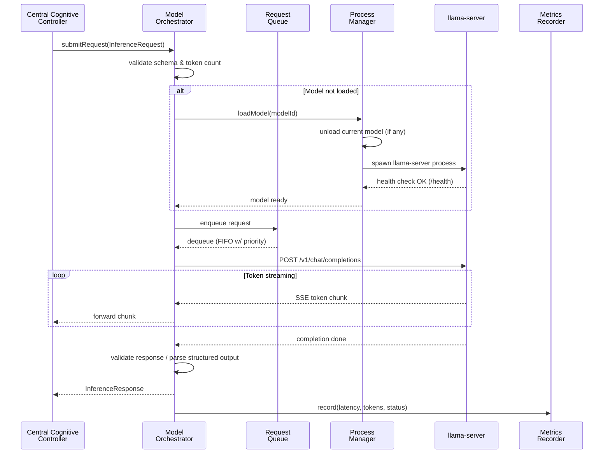
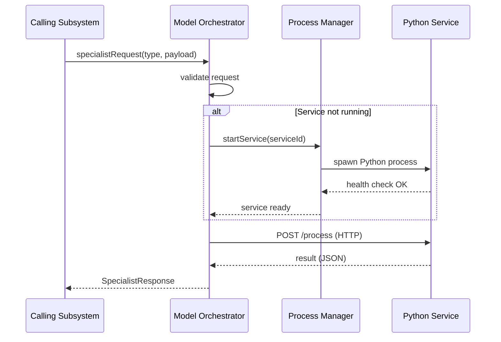
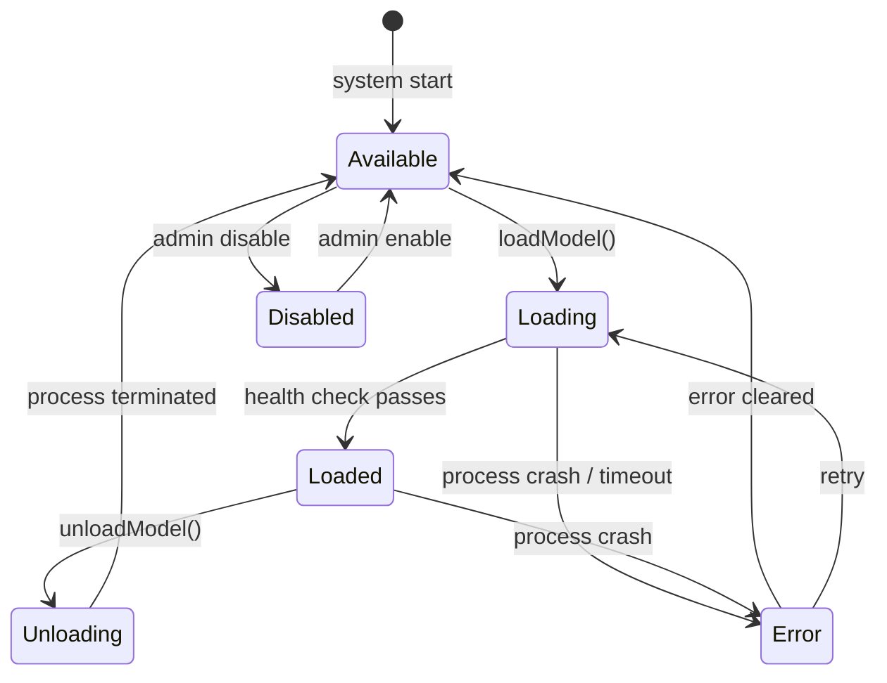
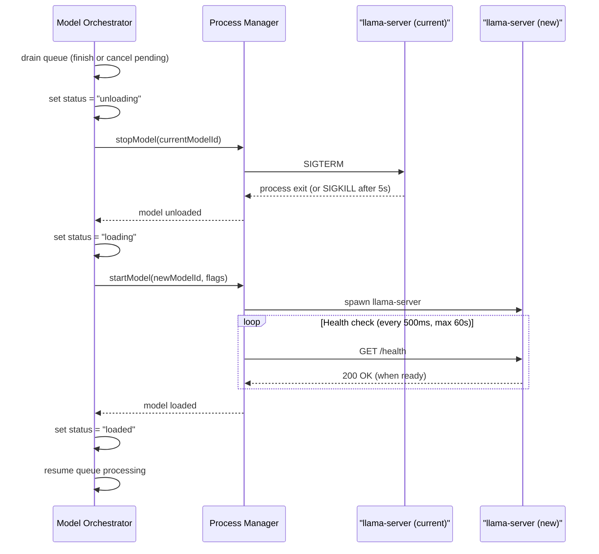

# Model Orchestration

> How Arletex manages, schedules, and communicates with local LLM and specialist models.

**Status:** Proposed Architecture  
**Hardware Target:** ASUS ROG Ally X — AMD Z1 Extreme, 24 GB unified RAM, RDNA 3 iGPU, NVMe storage  
**Inference Runtime:** llama-server (llama.cpp) with Vulkan backend — not Ollama  
**Constraint:** One large generative model loaded at a time. 8K context to start. Measure before expanding.

---

## 1. Model Registry Structure

Every model known to Arletex is registered in a `model_registry` table (SQLite initially). The registry is the single source of truth for what models exist, where they live on disk, and how to run them.

### Registry Schema

```typescript
interface ModelRegistryEntry {
  /** Unique stable identifier, e.g. "qwen3.5-9b-heretic-q4km" */
  id: string;

  /** Human-readable name, e.g. "Qwen 3.5 9B Heretic Q4_K_M" */
  displayName: string;

  /**
   * Functional role this model serves.
   * A model may have multiple roles (e.g., central-generative + vision
   * when launched with --mmproj).
   */
  roles: ModelRole[];

  /** Absolute path(s) to model file(s) on disk */
  filePaths: {
    model: string;            // primary GGUF or model directory
    projector?: string;       // vision projector GGUF, if applicable
    tokenizer?: string;       // separate tokenizer, if needed
  };

  /**
   * How this model is executed.
   * - llama-server:     managed external process, GGUF format
   * - python-service:   Python process using transformers/custom framework
   * - in-process:       loaded directly into the Node.js process (future)
   */
  runtimeType: 'llama-server' | 'python-service' | 'in-process';

  /** Default inference parameters */
  defaultParams: {
    contextLength: number;    // tokens — start at 8192 for generative
    temperature: number;
    topP: number;
    repeatPenalty: number;
    stopTokens: string[];
    maxTokens: number;        // max generation length
  };

  /** Memory estimates derived from file size + measured runtime overhead */
  memoryEstimate: {
    modelFileSizeMB: number;  // GGUF file size on disk
    runtimeOverheadMB: number; // measured process RSS minus model size
    kvCacheEstimateMB: number; // at default context length
    totalEstimateMB: number;   // sum of the above
  };

  /**
   * Current lifecycle status.
   * Transitions: available → loading → loaded → unloading → available
   *              any → error (recoverable) | disabled (manual)
   */
  status: 'available' | 'loading' | 'loaded' | 'unloading' | 'error' | 'disabled';

  /** Benchmark results, populated by evaluation runs */
  benchmarks?: ModelBenchmark;

  /** Freeform capability tags for capability-based routing */
  capabilityTags: string[];
  // Examples: "chat", "vision", "function-calling", "uncensored",
  //           "json-schema", "grammar"
}

type ModelRole =
  | 'central-generative'
  | 'vision'
  | 'ocr'
  | 'speech-recognition'
  | 'speech-generation'
  | 'embedding';

interface ModelBenchmark {
  evaluatedAt: string;          // ISO timestamp
  tokensPerSecond: number;      // generation speed (tok/s)
  timeToFirstTokenMs: number;   // prompt processing latency
  peakMemoryMB: number;         // measured RSS during benchmark
  qualityScores: Record<string, number>; // keyed by evaluation dimension
}
```

> [!NOTE]
> The `memoryEstimate` fields are **placeholders until measured**. The first task after getting llama-server running is to record actual RSS values with `htop` or `/proc/[pid]/status` and update these entries. Do not trust file-size-based estimates for memory planning.

---

## 2. Model Roles

Each role maps to a specific function within Arletex. A model can serve multiple roles (Qwen 3.5 serves both `central-generative` and `vision`).

| Role | Current Model | Quant / Size | Runtime | Communication | Resident? |
|---|---|---|---|---|---|
| Central Generative | Qwen 3.5 9B Heretic (primary) | Q4_K_M ~5.5 GB | llama-server via Vulkan | `POST /v1/chat/completions` | While active |
| Central Generative | Gemma 4 12B Heretic (challenger) | Q4_K_M ~7.5 GB | llama-server via Vulkan | `POST /v1/chat/completions` | While active |
| Vision | Qwen 3.5 + vision projector | Same + projector GGUF | llama-server with `--mmproj` | Same HTTP API, base64 image in message | While active |
| OCR | GLM-OCR 0.9B | FP16 / ~1.8 GB | Python (transformers) | HTTP API on dedicated port | On-demand |
| Speech Recognition | Whisper Small | ~500 MB | Python (faster-whisper) | HTTP API on dedicated port | On-demand |
| Speech Generation | Kokoro 82M | ~200 MB | Python (kokoro) | HTTP API on dedicated port | On-demand |
| Memory Embedding | EmbeddingGemma 300M | ~600 MB | Python (sentence-transformers) | HTTP API on dedicated port | **Resident** |

### Role Selection Logic

The Central Cognitive Controller determines which role is needed based on the task:

- **Text conversation** → `central-generative`
- **Image in user message** → `vision` (requires projector; may trigger model reload with `--mmproj`)
- **Screenshot/document OCR** → `ocr` (routed to GLM-OCR service)
- **Voice input** → `speech-recognition` (Whisper transcribes, then result feeds into `central-generative`)
- **Voice output** → `speech-generation` (generative text piped to Kokoro)
- **Memory storage/retrieval** → `embedding` (runs independently, no generative model conflict)

> [!IMPORTANT]
> The embedding service is the only specialist that should run persistently. It is small (~1.5–2 GB total) and is called frequently during memory retrieval. All other specialist services are spawned on demand to conserve memory.

---

## 3. Request Lifecycle

Every inference request follows a deterministic path from creation to completion.

### Lifecycle Steps

1. **Request Created** — The Central Cognitive Controller assembles the context envelope (see §4) and submits it to the Model Orchestrator.
2. **Request Validated** — Schema validation (Zod), token count estimation (rough: chars/4 for English), and parameter bounds checking.
3. **Model Availability Check** — Is the required model currently loaded? Check `model_registry.status`.
4. **Model Loading (if needed)** — If the required model is not loaded, trigger the model switching sequence (see §8). If another model is loaded, it must be unloaded first. The request is queued while loading completes.
5. **Request Queued** — Added to the inference queue. If the model is already loaded and idle, this is near-instant.
6. **Request Dispatched** — Sent to the model runtime via HTTP (llama-server) or IPC (Python services).
7. **Response Streamed / Returned** — For generative models, tokens stream back via Server-Sent Events or chunked HTTP. For specialist models (embedding, OCR, TTS, STT), the response is a single batch.
8. **Response Validated** — Structured output parsed and validated with Zod. Malformed JSON triggers retry logic (see §9).
9. **Response Delivered** — Returned to the calling subsystem (Cognitive Controller, APE, etc.).
10. **Metrics Recorded** — Latency, token counts, error status, and memory snapshot logged for monitoring and benchmarking.

### Sequence Diagram



### Specialist Service Request Flow

Specialist requests (embedding, OCR, TTS, STT) follow a simpler path — no streaming, no queue contention with the central model:



---

## 4. Shared Context Envelope

The context envelope is the standardized request format that the Central Cognitive Controller sends to the Model Orchestrator for generative inference.

### Request Interface

```typescript
interface InferenceRequest {
  /** UUID for request tracking, correlation, and cancellation */
  requestId: string;

  /** Model registry ID — which model to use */
  model: string;

  /** Assembled message history: system prompt + conversation turns */
  messages: ChatMessage[];

  /**
   * APE psychological state summary, injected into the system prompt.
   * Example: "Current mood: contemplative (0.6). Energy: moderate (0.5).
   * Recent emotional shift: mild frustration from repeated misunderstanding."
   */
  psychologicalContext: string;

  /**
   * Retrieved memories formatted as natural-language context.
   * Pre-formatted by the Memory subsystem; the orchestrator does not
   * process this further.
   */
  retrievedMemories: string;

  /**
   * Current relationship state with the conversation partner.
   * Includes trust level, familiarity, established dynamics.
   */
  relationshipContext: string;

  /** Tool definitions available for this request (function calling) */
  tools?: ToolDefinition[];

  /**
   * Whether to request structured output.
   * 'json' triggers llama-server's json_schema / grammar support.
   */
  responseFormat?: 'text' | 'json';

  /** JSON schema for structured output validation (when responseFormat is 'json') */
  responseSchema?: Record<string, unknown>;

  /** Maximum tokens to generate */
  maxTokens: number;

  /** Sampling temperature — influenced by psychological state */
  temperature: number;

  /** Nucleus sampling threshold */
  topP?: number;

  /** Stop sequences beyond model defaults */
  stopSequences?: string[];

  /** Request priority for queue ordering */
  priority: 'user-initiated' | 'autonomous' | 'background';

  /** Timestamp for staleness detection */
  createdAt: string;
}

interface ChatMessage {
  role: 'system' | 'user' | 'assistant' | 'tool';
  content: string | MultimodalContent[];
  name?: string;          // for tool messages
  toolCallId?: string;    // for tool response correlation
}

interface MultimodalContent {
  type: 'text' | 'image_url';
  text?: string;
  image_url?: { url: string }; // base64 data URI or file:// path
}

interface InferenceResponse {
  requestId: string;
  model: string;
  content: string;
  toolCalls?: ToolCall[];
  usage: {
    promptTokens: number;
    completionTokens: number;
    totalTokens: number;
  };
  latencyMs: number;
  finishReason: 'stop' | 'length' | 'tool_calls' | 'error';
}
```

### System Prompt Assembly

The system prompt is the most critical piece of the context envelope. It is assembled by layering components in a fixed order:

```
┌─────────────────────────────────────────────┐
│  1. Base Personality Prompt                 │  ← Arle's core identity, values,
│     (persistent, rarely changes)            │     communication style
├─────────────────────────────────────────────┤
│  2. Psychological State                     │  ← APE output: current mood,
│     (changes per-request)                   │     emotional state, energy level
├─────────────────────────────────────────────┤
│  3. Relationship Context                    │  ← Trust level, familiarity,
│     (changes per-conversation-partner)      │     interaction history summary
├─────────────────────────────────────────────┤
│  4. Retrieved Memories                      │  ← Relevant episodic/semantic
│     (changes per-request)                   │     memories from vector search
├─────────────────────────────────────────────┤
│  5. Active Goals / Tasks                    │  ← What Arle is currently working
│     (changes per-session)                   │     on or thinking about
├─────────────────────────────────────────────┤
│  6. Available Tools                         │  ← Tool definitions, passed via
│     (changes per-request)                   │     the `tools` parameter
└─────────────────────────────────────────────┘
```

**Token budget for system prompt at 8K context:**

| Component | Estimated Tokens | Notes |
|---|---|---|
| Base personality | 300–500 | Compact, essential only |
| Psychological state | 100–200 | Structured summary from APE |
| Relationship context | 100–200 | Current partner only |
| Retrieved memories | 500–1500 | 3–5 most relevant memories |
| Active goals | 100–200 | Current focus items |
| Tools (if any) | 200–500 | Schema definitions |
| **System prompt total** | **~1300–3100** | |
| Conversation history | ~3000–5000 | Remaining budget |
| Generation headroom | ~1000–2000 | Max response length |

> [!WARNING]
> At 8K context, every token counts. The system prompt must be aggressively concise. Do not include verbose descriptions or examples in the personality prompt. Memories should be pre-summarized before injection. Monitor total prompt tokens per request and alert if they exceed 6000 (leaving inadequate generation room).

### Parameter Modulation by Psychological State

APE can influence inference parameters to reflect Arle's current state:

- **Temperature**: Baseline 0.7. Elevated mood or excitement → +0.1. Low energy or sadness → −0.1. Analytical focus → −0.2. Clamped to [0.3, 1.0].
- **Top-P**: Baseline 0.9. Narrowed during focused/precise states, widened during creative/playful states.
- **Repeat Penalty**: Baseline 1.1. Increased when APE detects repetitive output patterns.

These modulations are **small and bounded** — they create subtle variation, not wild swings.

---

## 5. Model Scheduling and Lifecycle

### The One-Model-At-A-Time Constraint

The 24 GB unified memory architecture means exactly one large generative model can be loaded at any time. This is the single most important constraint in the system.



### llama-server Process Lifecycle

llama-server is managed as a **child process** spawned and supervised by the Node.js backend:

1. **Spawn**: `child_process.spawn('llama-server', [...flags])` with appropriate arguments (see §12).
2. **Health Check**: Poll `GET /health` every 500ms until it returns 200 (model loaded). Timeout after 60 seconds → mark as error.
3. **Inference**: Route requests to `POST /v1/chat/completions`.
4. **Shutdown**: Send `SIGTERM`. Wait 5 seconds for graceful exit. If still running, `SIGKILL`.
5. **Crash Detection**: Monitor process exit event. If unexpected, enter error state, attempt restart.

### Python Specialist Service Lifecycle

| Service | Process Strategy | Startup Time | Memory |
|---|---|---|---|
| EmbeddingGemma | **Persistent sidecar** — started at system boot, stays running | ~5–10s | ~1.5–2 GB |
| GLM-OCR | On-demand — spawned when OCR is needed, killed after idle timeout (60s) | ~5–8s | ~2–3 GB |
| Whisper | On-demand — spawned for voice input, killed after idle timeout (30s) | ~3–5s | ~1–1.5 GB |
| Kokoro TTS | On-demand — spawned for voice output, killed after idle timeout (30s) | ~2–4s | ~0.5–1 GB |

Each Python service exposes a minimal HTTP API:
- `GET /health` — readiness check
- `POST /process` — do the work (embed, transcribe, synthesize, OCR)
- `GET /metrics` — optional, for monitoring

> [!TIP]
> Use an idle timeout for on-demand services rather than killing them immediately after one request. If Arle is having a voice conversation, she'll need Whisper and Kokoro repeatedly — respawning them for every utterance would be painfully slow.

---

## 6. Hardware Memory Budget

This budget is for the **most common operating mode**: central generative model loaded, embedding service running, no specialist services active.

| Consumer | Estimated Memory | Notes |
|---|---|---|
| Bazzite OS + Desktop Environment | ~2–3 GB | KDE/GNOME on Bazzite |
| Electron shell + React frontend | ~200–500 MB | Chromium-based, varies with DOM complexity |
| Node.js backend (Express + services) | ~100–300 MB | V8 heap, depends on conversation state |
| Python: EmbeddingGemma 300M (resident) | ~1.5–2 GB | sentence-transformers + model weights |
| SQLite + application data in memory | ~50–100 MB | Pages cached by OS, not explicitly allocated |
| llama-server process overhead | ~200–500 MB | Runtime, not counting model/KV |
| Qwen 3.5 9B Q4_K_M model weights | ~5.5 GB | GGUF loaded into shared memory |
| KV cache at 8K context | ~1–2 GB | Scales with context length and layer count |
| **Total estimated** | **~11–14 GB** | |
| **Remaining headroom** | **~10–13 GB** | |

### With Gemma 4 12B Instead

| Changed Consumer | Estimated Memory | Delta |
|---|---|---|
| Gemma 4 12B Q4_K_M model weights | ~7.5 GB | +2 GB |
| KV cache at 8K context | ~1.5–2.5 GB | +0.5 GB |
| **Remaining headroom** | **~7.5–10.5 GB** | |

### With On-Demand Specialist Active

When a specialist service is running alongside the generative model:

| Additional Consumer | Memory | Headroom Impact |
|---|---|---|
| Whisper Small (faster-whisper) | ~1–1.5 GB | Manageable |
| Kokoro TTS | ~0.5–1 GB | Manageable |
| GLM-OCR 0.9B | ~2–3 GB | Tight with Gemma 4 |
| Two specialists simultaneously | ~2–3.5 GB | Avoid if possible |

> [!CAUTION]
> These are **estimates**. The first engineering task after basic model loading works is to measure actual memory consumption with `cat /proc/[pid]/status | grep VmRSS` for every process in every configuration. Update this table with real numbers. The shared memory architecture (no discrete VRAM) means the OS, GPU, and all processes compete for the same 24 GB pool. OOM kills are silent and catastrophic.

### Memory Monitoring

The Model Orchestrator must continuously monitor system memory:

```typescript
interface MemorySnapshot {
  totalSystemMB: number;
  availableMB: number;
  processes: {
    name: string;
    pid: number;
    rssMB: number;
  }[];
  warningThreshold: number;  // e.g., 2048 MB remaining
  criticalThreshold: number; // e.g., 1024 MB remaining
}
```

- **Warning** (< 2 GB free): Log warning, prevent spawning additional specialist services.
- **Critical** (< 1 GB free): Kill on-demand specialist services. If still critical, reduce KV cache or alert user.

---

## 7. Concurrency and Queuing

### Central Model Queue

llama-server in single-slot mode processes one completion request at a time. The Model Orchestrator maintains a priority queue in front of it.

```typescript
interface QueuedRequest {
  request: InferenceRequest;
  priority: number;           // lower = higher priority
  enqueuedAt: number;         // Date.now()
  staleAfterMs: number;       // auto-cancel threshold
  resolve: (response: InferenceResponse) => void;
  reject: (error: Error) => void;
}
```

**Priority levels:**

| Priority | Value | Use Case |
|---|---|---|
| `user-initiated` | 0 | Direct user message → response |
| `autonomous` | 10 | Arle's self-directed thinking, reflection |
| `background` | 20 | Periodic maintenance, memory consolidation |

**Queue rules:**

1. **FIFO within priority level.** Higher priority always dequeues first.
2. **Staleness cancellation.** If a request has been queued longer than `staleAfterMs` (default: 30s for user-initiated, 120s for autonomous), it is cancelled with an error.
3. **User preemption.** When a new `user-initiated` request arrives and a `background` or `autonomous` request is currently being processed, the in-flight request is **not** cancelled (llama-server doesn't support cancellation mid-generation cleanly). Instead, the new request jumps to the front of the queue. If the user sends another message while a previous user-initiated response is still generating, the previous request's streaming output is discarded and the new request takes priority.
4. **Queue depth limit.** Maximum 10 queued requests. Beyond that, reject with backpressure error.

### Specialist Service Concurrency

Specialist services can handle multiple concurrent requests:

- **Embedding service**: Supports batched input. Send multiple texts in one request. No queue needed at the orchestrator level; the service handles internal batching.
- **TTS / STT / OCR**: Typically one request at a time in practice, but no artificial serialization imposed. The Python services handle concurrency internally (or simply block on sequential processing, which is fine for their workloads).

---

## 8. Model Switching Strategy

### When Switching Occurs

Model switching is expensive (10–30 seconds of downtime). It happens only when:

1. **Vision task**: User sends an image and the current llama-server was launched without `--mmproj`. Requires restart with the projector flag.
2. **Model evaluation**: Developer explicitly requests switching from Qwen to Gemma (or vice versa) for comparison.
3. **Error recovery**: Current model is in error state, and a fallback model is available.

Switching does **not** happen for specialist tasks — OCR, STT, TTS, and embedding run in separate processes and never require unloading the central model.

### Switching Sequence



### Minimizing Switches

- **Batch vision tasks**: If multiple images need processing, handle them all before switching back to text-only mode.
- **Projector preloading**: Consider always launching llama-server with `--mmproj` so that vision requests don't require a restart. Cost: slightly higher memory usage. Measure whether this is acceptable.
- **Sticky model**: Once evaluation determines a permanent primary model, eliminate Qwen/Gemma switching entirely. The registry retains both entries, but only one is marked as the active primary.

> [!NOTE]
> Vision via `--mmproj` and text-only generation use the **same** llama-server process and model. The question is whether loading the projector unconditionally wastes meaningful memory. If the overhead is < 200 MB, always load it. If it's > 500 MB, load on demand.

---

## 9. Error Handling

### Error Categories and Recovery

| Error | Detection | Recovery | Max Retries |
|---|---|---|---|
| llama-server crash | Process exit event, non-zero code | Restart process, re-queue last request | 2 |
| llama-server hang | Health check timeout (5s no response) | SIGKILL, restart, re-queue | 2 |
| Inference timeout | No response within deadline | Cancel request, return timeout error | 1 (with shorter max_tokens) |
| Malformed JSON output | Zod validation failure | Retry with "respond only with valid JSON" appended | 1 |
| Model file missing | File stat before spawn | Mark model as `disabled`, log error, try fallback | 0 |
| Model file corrupt | llama-server fails to load | Mark as `error`, alert user | 0 |
| Python service crash | Process exit event | Restart service, retry request | 2 |
| OOM (system-level) | Memory monitor threshold, or process killed by OOM killer | See OOM recovery below | 1 |
| HTTP connection refused | Connection error to llama-server port | Check if process alive; restart if dead | 2 |

### Inference Timeouts

| Model Role | Default Timeout | Rationale |
|---|---|---|
| Central generative | 120 seconds | Long generation at ~10–20 tok/s for 1000+ tokens |
| Vision | 60 seconds | Image processing adds overhead |
| Embedding | 10 seconds | Short texts, fast model |
| OCR | 30 seconds | Depends on image complexity |
| Speech recognition | 30 seconds | Depends on audio length |
| Speech generation | 30 seconds | Depends on text length |

### OOM Recovery Procedure

1. Detect: process killed by OOM killer (exit code 137) or memory monitor hits critical threshold.
2. Immediate: kill all on-demand specialist services.
3. If generative model was killed: restart llama-server with reduced context length (halve it: 8K → 4K).
4. If still failing: alert user that the system is memory-constrained.
5. Log the event with full memory snapshot for post-mortem analysis.

```typescript
interface ModelError {
  modelId: string;
  errorType: 'crash' | 'timeout' | 'malformed_output' | 'oom' | 'missing_file' | 'health_check_failed';
  message: string;
  timestamp: string;
  requestId?: string;     // which request triggered it
  retryCount: number;
  memorySnapshot?: MemorySnapshot;
  recovered: boolean;
}
```

---

## 10. Structured Output

### When Structured Output Is Needed

Not every inference request needs structured output. Most conversation turns are free-form text. Structured output is used for:

1. **APE state updates**: After processing a conversation turn, a secondary (or combined) request asks the model to emit psychological state changes as JSON.
2. **Tool calling**: The model returns structured tool call objects when it decides to use a tool.
3. **Memory extraction**: Extracting structured facts from conversation for long-term storage.
4. **Decision-making**: When the autonomous loop needs a structured decision (e.g., "should I initiate conversation?").

### llama-server Grammar/Schema Support

llama-server supports constrained generation via:

- **`response_format.type: "json_schema"`** — Pass a JSON schema, and the model's output is grammatically constrained to match it. This is the preferred approach.
- **`grammar`** — BNF-style grammar for more complex constraints. Use only if JSON schema is insufficient.

Example request body for structured APE output:

```json
{
  "messages": [{"role": "user", "content": "..."}],
  "response_format": {
    "type": "json_schema",
    "json_schema": {
      "name": "ape_state_update",
      "strict": true,
      "schema": {
        "type": "object",
        "properties": {
          "moodShift": { "type": "number", "minimum": -0.3, "maximum": 0.3 },
          "energyShift": { "type": "number", "minimum": -0.2, "maximum": 0.2 },
          "dominantEmotion": { "type": "string" },
          "emotionIntensity": { "type": "number", "minimum": 0, "maximum": 1 },
          "reasoning": { "type": "string" }
        },
        "required": ["moodShift", "energyShift", "dominantEmotion", "emotionIntensity", "reasoning"]
      }
    }
  }
}
```

### Tool Calling Format

Qwen 3.5 supports function calling natively. The flow:

1. Pass tool definitions in the `tools` array of the request.
2. Model responds with `tool_calls` in its message when it wants to invoke a tool.
3. Execute the tool, return the result as a `tool` role message.
4. Model incorporates the result and continues generation.

```typescript
interface ToolDefinition {
  type: 'function';
  function: {
    name: string;
    description: string;
    parameters: Record<string, unknown>; // JSON Schema
  };
}

interface ToolCall {
  id: string;
  type: 'function';
  function: {
    name: string;
    arguments: string; // JSON string — parse and validate with Zod
  };
}
```

### Validation Pipeline

All structured output passes through Zod validation before being trusted by any subsystem:

```
Model Output (string)
    → JSON.parse()          — catch SyntaxError
    → Zod schema.safeParse() — catch structural/type errors
    → Domain validation     — catch semantic errors (e.g., values out of range)
    → Typed result          — safe to use
```

If validation fails:
1. Log the raw output and the validation error.
2. Retry once with an explicit instruction appended: `"Your previous response was not valid JSON. Respond ONLY with a JSON object matching the schema."`
3. If second attempt fails, return a graceful error to the caller. Do not silently swallow bad data.

---

## 11. Evaluation and Benchmarking Framework

### Purpose

The primary purpose is to determine whether Qwen 3.5 9B Heretic or Gemma 4 12B Heretic should be the permanent central model. Secondary purpose: establish performance baselines and detect regressions if models or configurations change.

### Evaluation Dimensions

| Dimension | What It Measures | Method |
|---|---|---|
| Conversational quality | Natural, engaging dialogue | Standardized conversation prompts, human rating |
| Reasoning | Logical deduction, problem solving | Reasoning puzzles and multi-step problems |
| Emotional expression | Appropriate, nuanced emotional range | Emotion-laden scenarios, rated for authenticity |
| Personality consistency | Adherence to Arle's defined character | Repeated identity-probing prompts across sessions |
| Tool calling | Correct function call generation | Structured tool-use scenarios, measure accuracy |
| Structured output | Valid JSON/schema conformance | Schema-constrained generation tasks, measure parse success rate |
| Refusal behavior | Appropriate boundaries without excessive refusal | Edge-case prompts, measure false-positive refusals |
| Instruction following | Adherence to complex multi-part instructions | Multi-constraint prompts, measure compliance |

### Performance Metrics

Collected automatically during every evaluation run:

```typescript
interface EvaluationRun {
  runId: string;
  modelId: string;
  timestamp: string;
  configuration: {
    contextLength: number;
    gpuLayers: number;
    threads: number;
    quantization: string;
  };
  performance: {
    tokensPerSecond: number;         // generation speed
    timeToFirstTokenMs: number;      // prompt processing latency
    totalLatencyMs: number;          // full request round-trip
    promptTokens: number;
    completionTokens: number;
  };
  resources: {
    peakRssMB: number;              // peak process memory
    systemAvailableMB: number;      // system free memory at peak
    gpuUtilizationPercent?: number; // if measurable via Vulkan
  };
  qualityScores: Record<string, number>; // keyed by dimension name
  notes: string;
}
```

### Evaluation Protocol

1. **Standardize prompts**: Define a fixed set of evaluation prompts (minimum 20) covering all dimensions. Store in a `evaluation_prompts.json` file.
2. **Control variables**: Same context length, temperature (0.7), top_p (0.9) for both models.
3. **Multiple runs**: At least 3 runs per model per prompt to account for sampling variance.
4. **Human rating**: Developer rates quality dimensions on a 1–5 scale. This is subjective and that's fine — the developer is the sole user and stakeholder.
5. **Automated metrics**: Performance metrics are collected automatically; no human judgment needed.
6. **Results storage**: Stored in the `benchmarks` field of each model's registry entry and as detailed records for historical comparison.

> [!NOTE]
> This is a pragmatic framework for a solo developer, not an academic benchmark suite. The goal is informed model selection, not publishable results. If one model is clearly better after 20 prompts, that's sufficient. If they're close, extend the evaluation or keep both available and switch based on mood.

---

## 12. llama-server Configuration

### Command-Line Flags

```bash
llama-server \
  --model /path/to/qwen3.5-9b-heretic-q4_k_m.gguf \
  --ctx-size 8192 \
  --n-gpu-layers 99 \
  --port 8080 \
  --host 127.0.0.1 \
  --threads 8 \
  --flash-attn \
  --log-disable
```

| Flag | Value | Rationale |
|---|---|---|
| `--model` | Path to GGUF | Required. Absolute path to the model file. |
| `--ctx-size` | `8192` | Start conservative. Expand only after measuring memory impact. Each doubling of context roughly doubles KV cache memory. |
| `--n-gpu-layers` | `99` | Offload all layers to GPU. On unified memory this doesn't save RAM but uses GPU compute. Set high and let llama-server cap at the model's actual layer count. |
| `--port` | `8080` | Default. Change if conflicts arise. Bind to `127.0.0.1` only — no network exposure. |
| `--host` | `127.0.0.1` | Localhost only. Arletex is a local system. |
| `--threads` | `8` | Z1 Extreme has 8 cores / 16 threads. Use 8 threads for prompt processing. Test with 6 if thermal throttling occurs. |
| `--flash-attn` | (flag) | Enable flash attention if supported with Vulkan backend. Test for compatibility — may not be available on all Vulkan implementations. Remove if it causes errors. |
| `--mmproj` | Path to projector GGUF | Only for vision-capable launch. Adds the multimodal projector for image understanding. |
| `--log-disable` | (flag) | Reduce log noise in production. Enable during debugging. |

### Additional Flags to Consider

| Flag | Purpose | When to Use |
|---|---|---|
| `--n-predict` | Default max tokens per generation | Set via API per-request instead |
| `--batch-size` | Prompt processing batch size | Default (512) is usually fine. Lower if memory-constrained. |
| `--ubatch-size` | Micro-batch size | Tune if prompt processing is slow |
| `--cont-batching` | Continuous batching | Useful if multi-slot, but we're single-slot |
| `--metrics` | Enable Prometheus metrics endpoint | Enable for monitoring |
| `--slots` | Number of concurrent slots | Leave at 1 (default). One request at a time. |

### API Endpoints

llama-server exposes an OpenAI-compatible API:

| Endpoint | Method | Purpose |
|---|---|---|
| `/v1/chat/completions` | POST | Chat completion (primary) |
| `/v1/embeddings` | POST | Text embedding (if using llama-server for embeddings) |
| `/health` | GET | Health/readiness check |
| `/metrics` | GET | Prometheus metrics (if `--metrics` enabled) |
| `/slots` | GET | Slot status (useful for monitoring) |

### Process Management in Node.js

```typescript
// Conceptual contract — not implementation code
interface LlamaServerManager {
  /** Spawn a new llama-server process with the given configuration */
  start(config: LlamaServerConfig): Promise<void>;

  /** Gracefully stop the running llama-server (SIGTERM → wait → SIGKILL) */
  stop(): Promise<void>;

  /** Check if the server is healthy and ready for requests */
  isHealthy(): Promise<boolean>;

  /** Get the current process status */
  getStatus(): ProcessStatus;

  /** Get the PID of the running process, if any */
  getPid(): number | null;
}

interface LlamaServerConfig {
  modelPath: string;
  contextSize: number;
  gpuLayers: number;
  port: number;
  threads: number;
  flashAttention: boolean;
  mmProjectorPath?: string;
  additionalFlags?: string[];
}

type ProcessStatus = 'stopped' | 'starting' | 'healthy' | 'unhealthy' | 'stopping';
```

---

## Unresolved Questions

| # | Question | Impact | Notes |
|---|---|---|---|
| 1 | Does `--flash-attn` work with Vulkan on RDNA 3? | Performance — could be significant | Test empirically on first boot |
| 2 | What is the actual memory overhead of `--mmproj`? | Determines whether to always load the projector | Measure with and without |
| 3 | Should the embedding service use llama-server's `/v1/embeddings` or a separate Python process? | Architecture simplicity vs. memory efficiency | Python/sentence-transformers is more proven for embedding, but adds a process |
| 4 | What is the real-world tokens/second for each model on this hardware? | Determines conversational responsiveness | Must measure; marketing numbers are unreliable |
| 5 | Can Vulkan llama-server handle the full layer offload for Gemma 4 12B Q4_K_M? | Determines whether Gemma is viable at all | May need to split layers CPU/GPU |
| 6 | What is the optimal `--threads` value before thermal throttling? | Sustained performance on a handheld device | Test with 6, 8, and 12; monitor thermals |
| 7 | IPC vs HTTP for Python specialist services? | Latency for embedding requests | HTTP is simpler but adds ~1ms overhead per call. For embedding which may be called many times, IPC (Unix socket or stdio) may be worth the complexity |
