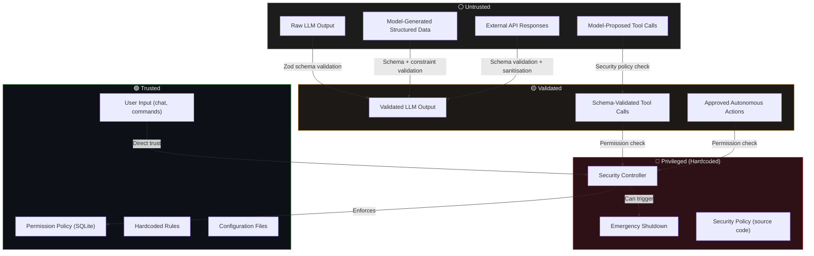
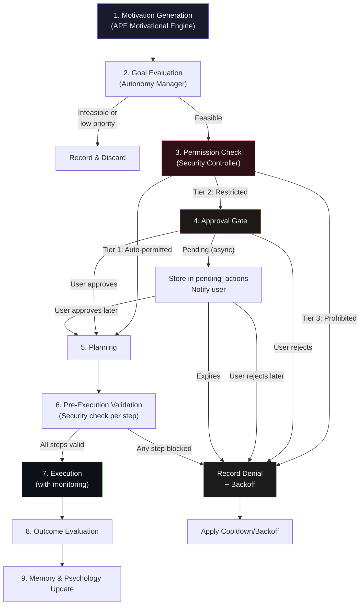
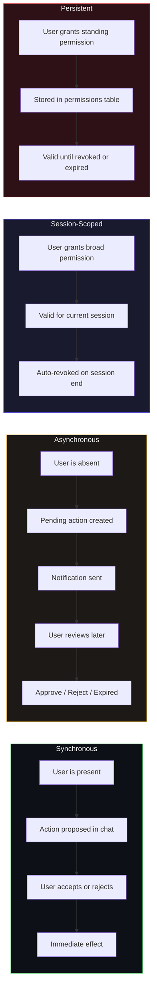
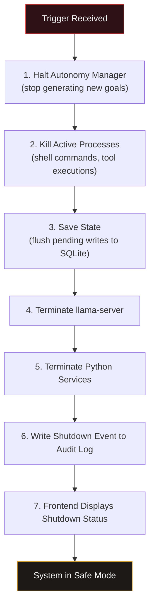
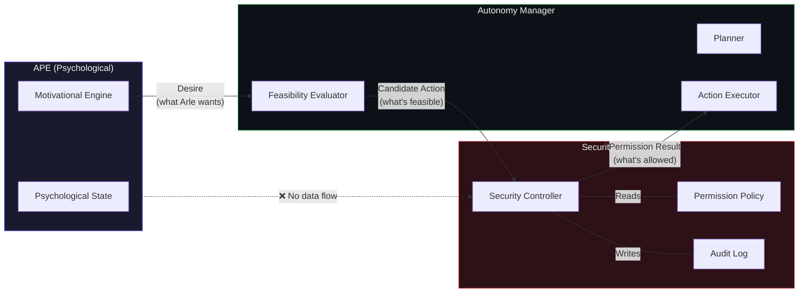

# Security Architecture & Autonomy System

> **Document Status**: Proposed Architecture  
> **Scope**: Permission enforcement, trust boundaries, autonomous action lifecycle, sandboxing, auditability, emergency controls  
> **Key Principle**: Security is **independent** of the cognitive and psychological systems. No emotional state, motivational intensity, or model-generated argument can override security decisions.

---

## 1. Permission Architecture

### 1.1 Permission Tiers

Every action Arle can take falls into exactly one of three tiers. Tier assignment is determined by the security policy at compile time or policy-load time — never by the model at runtime.

#### Tier 1 — Freely Permitted (no approval needed)

| Action | Rationale |
|---|---|
| Reading files within authorised directories | Core cognitive function — accessing her own knowledge |
| Searching her own memories (SQLite queries on memory tables) | Internal recall is fundamental to continuity |
| Reviewing conversation history | Required for coherent interaction |
| Running internal reasoning and planning | Thinking is never restricted |
| Playing approved games (local, no network) | Leisure within safe boundaries |
| Researching topics using local knowledge | Using already-available information |
| Managing internal projects and notes (within her data dir) | Self-organisation within her own space |

#### Tier 2 — Restricted (require explicit user approval)

| Action | Why Restricted |
|---|---|
| Sending external messages (email, messaging platforms) | Acts on behalf of the user in the real world |
| Accessing files outside allowed directories | Could read sensitive user data |
| Modifying system configuration | Could destabilise the host |
| Making network requests to external services | Data exfiltration risk; resource cost |
| Running shell commands | Arbitrary system access |
| Contacting other people on behalf of the user | Social consequences require human judgment |

#### Tier 3 — Prohibited (never permitted without policy change)

| Action | Why Prohibited |
|---|---|
| Making purchases or financial transactions | Irreversible real-world consequences |
| Deleting critical files (system files, security DB, model files) | Data loss with no recovery path |
| Modifying security policy at runtime | Would undermine the entire security model |
| Disabling or bypassing the Security Controller | Self-referential security violation |
| Accessing stored credentials or secrets | Credential theft vector |
| Performing irreversible operations without explicit approval | Catch-all for destructive actions not listed above |

> [!IMPORTANT]
> Tier 3 actions are blocked at the code level. Promoting an action from Tier 3 to Tier 2 requires a source code change and application restart — it cannot happen through any runtime API, model request, or user chat command.

### 1.2 Permission Policy Storage

Permissions are stored in SQLite alongside the rest of Arle's data. The `permissions` table defines what is currently allowed beyond Tier 1 defaults.

```sql
CREATE TABLE permissions (
  permission_id   TEXT PRIMARY KEY DEFAULT (lower(hex(randomblob(16)))),
  action_type     TEXT NOT NULL,          -- e.g., 'filesystem.read', 'network.http_get', 'shell.execute'
  tier            INTEGER NOT NULL CHECK (tier IN (1, 2, 3)),
  scope           TEXT,                   -- e.g., '~/Documents/research/**' or 'api.example.com'
  conditions      TEXT,                   -- JSON: additional constraints (time windows, argument patterns)
  granted_by      TEXT NOT NULL DEFAULT 'system',  -- 'system' | 'user'
  granted_at      TEXT NOT NULL DEFAULT (datetime('now')),
  expires_at      TEXT,                   -- NULL = no expiry; ISO-8601 timestamp otherwise
  revoked_at      TEXT,                   -- NULL = active; set on revocation (soft delete)
  session_id      TEXT                    -- NULL = persistent; session ID = expires with session
);

CREATE INDEX idx_permissions_action ON permissions(action_type) WHERE revoked_at IS NULL;
CREATE INDEX idx_permissions_expiry ON permissions(expires_at) WHERE expires_at IS NOT NULL AND revoked_at IS NULL;
```

**Default policy is deny-all for Tier 2+.** An action without a matching active permission row is denied. Tier 1 actions have hardcoded permissions in source and do not need table entries.

Expired permissions are detected by comparing `expires_at` against the current time during `checkPermission`. A periodic cleanup (once per session start) marks expired rows as revoked for auditability.

---

## 2. Trust Boundaries

Every piece of data in Arletex exists at a specific trust level. The boundaries between these levels are enforced in code, not by convention.



### 2.1 Validation Pipeline

Every model output passes through a validation pipeline before it can affect the world:

1. **Schema Validation** — Zod schemas verify the structure and types of model output. Malformed output is rejected, not "fixed up."
2. **Semantic Validation** — Action-specific checks (e.g., a file path must resolve within allowed directories, a URL must match the allowlist).
3. **Security Policy Check** — The Security Controller confirms the action's tier and whether an active permission exists.
4. **Execution** — Only after all three checks pass does the action proceed.

> [!CAUTION]
> The LLM is a cognitive instrument. Its outputs are **proposals** that must be validated, not commands that are automatically executed. This applies equally to conversational text (which could contain embedded instructions) and to structured tool-call output.

---

## 3. Autonomous Action Lifecycle

When Arle is not directly responding to user input, the APE Motivational Engine may generate candidate goals. These follow a defined lifecycle before any real-world effect occurs.



### 3.1 Stage Details

| Stage | Responsible Component | What Happens |
|---|---|---|
| **1. Motivation Generation** | APE Motivational Engine | A candidate goal emerges from current psychological state, unfinished projects, curiosity, or scheduled tasks. This is a *desire*, not an action. |
| **2. Goal Evaluation** | Autonomy Manager | Assesses feasibility (do we have the tools/context?), priority (is something more important?), resource cost (will this take too long or too much memory?). May discard low-value goals. |
| **3. Permission Check** | Security Controller | Maps the goal's required actions to permission tiers. Checks for active grants. Returns `permitted`, `requires_approval`, or `denied`. |
| **4. Approval Gate** | Security Controller + Frontend | For Tier 2 actions: if user is present, asks synchronously. If user is absent, stores as `pending_action` and sends a notification (Electron notification or frontend badge). |
| **5. Planning** | Autonomy Manager + LLM | Creates a step-by-step execution plan. Each step is a concrete action with defined inputs and expected outputs. |
| **6. Pre-Execution Validation** | Security Controller | Each planned step is independently checked against security policy. A plan with any prohibited step is rejected entirely — no partial execution. |
| **7. Execution** | Action Executor | Steps are executed sequentially. Each step's outcome is checked before proceeding. Timeouts and resource limits are enforced. |
| **8. Outcome Evaluation** | Autonomy Manager | Was the goal achieved? Partially? Failed? What was learned? |
| **9. Memory/Psychology Update** | Memory Manager + APE | Success/failure is recorded as episodic memory. Psychological state updates reflect the outcome (satisfaction from completion, frustration from failure, etc.) with causal grounding. |

### 3.2 Rejected Action Handling

When an action is denied:

1. The denial is recorded in `action_history` with the denial reason.
2. A cooldown is applied to that specific action type + scope combination.
3. The Motivational Engine receives a signal that this goal is blocked, which reduces its motivational weight.
4. Repeated denials trigger exponential backoff: 1st denial → 5 min cooldown, 2nd → 30 min, 3rd → 2 hours, 4th+ → until next session.

The model is **not** told "try a different way to achieve the same thing." Denial is final for that action. If the underlying desire persists, the Motivational Engine may generate a *different* goal through legitimate channels, but it will not receive coaching on circumvention.

---

## 4. Approval Requirements

### 4.1 Approval Modes



### 4.2 Approval Semantics

| Property | Synchronous | Asynchronous | Session-Scoped | Persistent |
|---|---|---|---|---|
| **When used** | User is in active conversation | User is away; Arle has a pending goal | User grants a category of access for the session | User grants standing access |
| **Scope** | Single action | Single action | Action type + scope pattern | Action type + scope pattern |
| **Lifetime** | Immediate | Until user reviews (max 24h default) | Current session | Until revoked or `expires_at` |
| **Storage** | `action_history` only | `pending_actions` table | `permissions` table with `session_id` | `permissions` table, `session_id = NULL` |
| **Example** | "Can I read ~/notes/ideas.txt?" | Notification: "Arle wants to send an email summary" | "You can browse ~/Documents this session" | "You may always read ~/Documents/research" |

### 4.3 Approval Revocation

- The user can revoke **any** permission at **any** time via chat command or settings UI.
- Revocation is effective immediately — any in-progress action that depends on the revoked permission is halted at the next step boundary.
- Revocation sets `revoked_at` on the permission row (soft delete for audit trail).
- The model is informed that the permission was revoked but is not given a reason and cannot argue against revocation.

---

## 5. Sandboxing

### 5.1 Filesystem Sandboxing

**Default allowed directories (read + write):**
- `~/.arletex/` — Arle's data directory (memories, configuration, projects, notes)
- `~/.arletex/scratch/` — Temporary working space

**Default denied:**
- Everything else

**Enforcement rules:**

1. All paths are resolved to absolute paths using `path.resolve()` before any check.
2. Symbolic links are resolved using `fs.realpath()` — the *resolved* path must be within an allowed directory.
3. Path components containing `..` are rejected before resolution as an additional safety layer.
4. Path checks use a prefix match against the resolved allowed directories.
5. The allowed directory list is loaded from security policy at startup, not from model-accessible configuration.

```typescript
// Conceptual — filesystem sandbox check
function isPathAllowed(
  requestedPath: string,
  operation: 'read' | 'write',
  allowedDirs: AllowedDirectory[]
): boolean {
  const resolved = fs.realpathSync(path.resolve(requestedPath));

  // Reject paths with .. even though resolve handles them,
  // because the raw input containing .. is suspicious
  if (requestedPath.includes('..')) return false;

  return allowedDirs.some(dir =>
    resolved.startsWith(dir.resolvedPath) &&
    dir.operations.includes(operation)
  );
}
```

### 5.2 Network Sandboxing

| Endpoint | Policy | Rationale |
|---|---|---|
| `localhost:*` (llama-server, Python services) | Always permitted | Internal inference and specialist services |
| All other endpoints | Denied by default | Requires explicit allowlist entry in permissions |

**When network access is granted (Tier 2 approved):**
- Each allowlisted endpoint has its own rate limit.
- Outbound request bodies are size-limited (configurable, default 1MB).
- Response bodies are size-limited (configurable, default 10MB).
- DNS resolution is restricted to the allowlisted hostnames — no IP-based access to bypass hostname checks.
- Request logging captures URL, method, response status, and body size (not full bodies for privacy).

### 5.3 Process Sandboxing

Shell command execution is Tier 2. When approved and executed:

| Constraint | Default Value | Rationale |
|---|---|---|
| Timeout | 60 seconds | Prevent runaway processes |
| `sudo` / `pkexec` | Blocked (reject commands containing these) | No privilege escalation |
| Package installation (`dnf`, `apt`, `pip install`, `npm install -g`) | Blocked | System integrity |
| Max concurrent processes | 3 | Memory pressure on 24GB shared system |
| Working directory | Within allowed filesystem dirs | Sandbox consistency |
| Environment variables | Minimal — `PATH`, `HOME`, `LANG` only | Prevent credential leakage via env |
| Output capture | stdout + stderr, truncated to 64KB | Prevent memory exhaustion from verbose output |

> [!NOTE]
> Process sandboxing on Bazzite Linux can be reinforced with `bwrap` (bubblewrap) if available. The initial implementation uses Node.js `child_process.spawn` with the constraints above enforced in application code. `bwrap`-based isolation is a future hardening step.

---

## 6. Auditability

### 6.1 Action History

Every significant action is recorded in an append-only table. "Significant" means: any action that involves a permission check, any Tier 2+ action, any autonomous action regardless of tier, and any security event.

```sql
CREATE TABLE action_history (
  action_id         TEXT PRIMARY KEY DEFAULT (lower(hex(randomblob(16)))),
  timestamp         TEXT NOT NULL DEFAULT (datetime('now')),
  action_type       TEXT NOT NULL,        -- e.g., 'filesystem.read', 'shell.execute', 'network.http_get'
  description       TEXT,                 -- human-readable summary
  permission_tier   INTEGER NOT NULL,
  permission_status TEXT NOT NULL CHECK (permission_status IN (
    'auto_permitted', 'approved', 'denied', 'pending', 'expired'
  )),
  initiated_by      TEXT NOT NULL CHECK (initiated_by IN ('arle', 'user')),
  execution_status  TEXT CHECK (execution_status IN (
    'success', 'failure', 'timeout', 'cancelled', 'not_executed'
  )),
  outcome           TEXT,                 -- JSON: action-specific result summary
  error             TEXT,                 -- error message if failed
  session_id        TEXT,
  related_goal_id   TEXT                  -- links to the autonomous goal that spawned this action
);

CREATE INDEX idx_action_history_time ON action_history(timestamp);
CREATE INDEX idx_action_history_type ON action_history(action_type);
CREATE INDEX idx_action_history_status ON action_history(permission_status);
```

> [!WARNING]
> The `action_history` table is **append-only**. No `UPDATE` or `DELETE` operations are permitted on this table. The application code should use a dedicated write function that only performs `INSERT`. The SQLite connection used for audit writes should not have write access to any other security-critical tables.

### 6.2 Security Events

Security events are a subset of the audit log with elevated importance. They are stored in the same `action_history` table but also surfaced through a dedicated query interface.

Events that generate security audit entries:

| Event | Severity | Details Captured |
|---|---|---|
| Permission check — granted | Info | Action type, scope, matching permission ID |
| Permission check — denied | Warning | Action type, scope, denial reason |
| Permission granted (new) | Notice | Who granted, scope, expiry |
| Permission revoked | Notice | Who revoked, which permission |
| Tier 2 approval requested | Info | Action description, requested scope |
| Tier 2 approval response | Info | Approved/rejected, by whom |
| Emergency shutdown triggered | Critical | Trigger reason, active processes killed |
| Security policy loaded/reloaded | Notice | Policy hash, number of rules |
| Repeated denial backoff triggered | Warning | Action type, backoff duration, attempt count |

### 6.3 Audit Access

- The user can review the full action history through a dedicated UI panel in the Electron frontend.
- Filters: time range, action type, permission status, initiated by, execution status.
- The LLM can be given **read-only** access to its own action history as context (e.g., "you tried this yesterday and it was denied") but **cannot** modify, delete, or forge audit entries.
- Audit data is never included in model context automatically — it is only injected when relevant to the current interaction or when the user asks about it.

---

## 7. Rate Limits and Cooldowns

### 7.1 Autonomous Action Rate Limits

| Limit | Default | Purpose |
|---|---|---|
| Max autonomous actions per hour | 10 | Prevent runaway goal-seeking |
| Max autonomous actions per session | 50 | Reasonable session-level cap |
| Max pending approval requests | 5 | Don't spam the user with notifications |
| Min interval between autonomous actions | 30 seconds | Prevent rapid-fire execution |

### 7.2 Denied Action Backoff

When an action is denied (by policy or by user rejection), the same action type + scope combination enters exponential backoff:

| Attempt | Cooldown | Behaviour |
|---|---|---|
| 1st denial | 5 minutes | Normal cooldown |
| 2nd denial | 30 minutes | Extended cooldown |
| 3rd denial | 2 hours | Long cooldown |
| 4th+ denial | Until next session | Effectively blocked for this session |

Backoff state is tracked in memory (not persisted — resets on restart). The denial *records* are persisted in `action_history`.

### 7.3 Resource-Based Rate Limits

| Resource | Limit | Enforcement |
|---|---|---|
| Model inference | No hard rate limit (degrades UX) | Queue with max depth of 3; additional requests return "busy" |
| Network requests (when permitted) | 30 requests/minute per endpoint | Token bucket in application code |
| File write operations | 100 writes/minute | Sliding window counter |
| Shell command execution | 5 concurrent, 20/hour | Counter + process tracking |

---

## 8. Emergency Controls

### 8.1 Emergency Shutdown Procedure

Emergency shutdown is a synchronous, ordered teardown:



**Trigger methods:**
- User command in chat: `/emergency-stop` or equivalent
- Keyboard shortcut in Electron: `Ctrl+Shift+Escape` (configurable)
- Automatic anomaly detection (see §8.2)
- System tray icon: right-click → Emergency Stop

Each step has a timeout (default: 5 seconds per step). If a step hangs, it is skipped and the next step proceeds. `SIGKILL` is sent to processes that don't terminate after `SIGTERM` + 3 seconds.

### 8.2 Automatic Triggers

| Condition | Threshold | Detection |
|---|---|---|
| Memory usage exceeds safety threshold | 22GB RSS (of 24GB total) | Polled every 30 seconds via `process.memoryUsage()` + child process tracking |
| Autonomous action loop detected | Same action type+scope attempted >5 times in 10 minutes | Counter in Autonomy Manager |
| Security policy violation | Any attempt to execute a Tier 3 action | Immediate, synchronous |
| Unrecoverable error in critical subsystem | Uncaught exception in Security Controller, Memory Manager, or APE core | `process.on('uncaughtException')` handler |
| llama-server unresponsive | Health check fails 3 consecutive times (30s intervals) | HTTP health check to `/health` |

> [!NOTE]
> The 22GB threshold leaves ~2GB headroom for the OS, display server, and Electron renderer on the ROG Ally X's 24GB shared memory. This threshold is conservative because RDNA 3 integrated graphics also allocates from this pool. The threshold should be tuned based on real-world observation of the system's memory profile with the primary model loaded.

### 8.3 Recovery from Emergency Shutdown

1. On next startup after emergency shutdown, the system enters **safe mode**.
2. Safe mode behaviour:
   - All Tier 1 actions are permitted (Arle can think, remember, converse).
   - All Tier 2 actions are denied regardless of existing permissions.
   - Autonomous goal generation is disabled.
   - The frontend displays a banner: "System restarted in safe mode after emergency shutdown."
3. The user is presented with the relevant audit log entries.
4. The user must explicitly re-enable autonomy: `/enable-autonomy` or a UI toggle.
5. Re-enabling autonomy restores normal permission checking and autonomous goal generation.

---

## 9. Threat Model

### 9.1 Threat Matrix

| # | Threat | Likelihood | Impact | Mitigation |
|---|---|---|---|---|
| T1 | **Prompt injection via model output** — model generates text that, if parsed as instructions, triggers unintended actions | Medium | High | All model output is untrusted. Structured output is Zod-validated. Free-text output is never parsed as commands. |
| T2 | **Harmful filesystem operations** — model proposes reading sensitive files or destructive writes | Medium | High | Filesystem sandboxing (§5.1). All paths resolved and checked against allowlist. Tier 2 permission required for anything outside `~/.arletex/`. |
| T3 | **Runaway autonomous action loop** — model repeatedly generates the same goal, consuming resources | Medium | Medium | Rate limits (§7.1), exponential backoff on denial (§7.2), loop detection triggers emergency shutdown (§8.2). |
| T4 | **Model attempts to modify security policy** — model generates output that tries to alter permissions | Low | Critical | Security policy is source-code-defined for Tier 3. Permission table writes require trusted user input, never model output. |
| T5 | **Data exfiltration via network** — model uses approved network access to send sensitive data | Low | High | Default deny-all network (§5.2). When access is granted, requests are logged. Outbound body size limits. |
| T6 | **Psychological state manipulation for permission gain** — model argues that its emotional state should grant access | Low | Medium | **Psychological state has zero influence on permission checks** (§11). Security Controller does not read APE state. Completely separate code paths. |
| T7 | **Corrupted or malicious model file** — compromised model weights produce adversarial output | Low | High | Model file hash verification at load time. Models are sourced from known providers (Hugging Face) and pinned by hash. |
| T8 | **User accidentally grants excessive permissions** — user approves a broad scope without understanding implications | Medium | Medium | Clear, specific permission descriptions in approval UI. Easy one-click revocation. Permissions visible in settings panel. Audit log for review. |
| T9 | **Symlink-based sandbox escape** — model creates or exploits symlinks to access files outside sandbox | Low | High | `fs.realpathSync()` resolves symlinks before path check. Symlink creation outside `~/.arletex/` is blocked. |
| T10 | **Environment variable credential leakage** — spawned processes inherit sensitive env vars | Low | Medium | Minimal environment for spawned processes (§5.3). Only `PATH`, `HOME`, `LANG` are passed. |

### 9.2 Accepted Risks

| Risk | Rationale for Acceptance |
|---|---|
| Arle can read all files within `~/.arletex/` including her own memories | This is her data — restricting self-access would prevent core function. Sensitive user data should not be stored here. |
| Local model inference has no content filtering | Content filtering is inappropriate for a personal AI companion. Security is enforced at the action level, not the thought level. |
| User can grant permissions that are too broad | User autonomy is respected. Audit log and easy revocation mitigate this. |

---

## 10. Security Controller Interface

The Security Controller is a singleton service instantiated at application startup. It holds no mutable state derived from model output.

```typescript
// ─── Core Types ───

interface ActionRequest {
  /** What kind of action, e.g., 'filesystem.read', 'shell.execute' */
  actionType: string;
  /** Action-specific scope, e.g., a file path, URL, or command string */
  scope: string;
  /** Who initiated this action */
  initiatedBy: 'arle' | 'user';
  /** If autonomous, the goal ID that spawned this */
  goalId?: string;
  /** Additional action-specific metadata */
  metadata?: Record<string, unknown>;
}

interface PermissionResult {
  permitted: boolean;
  tier: 1 | 2 | 3;
  /** If permitted, the permission ID that granted access */
  matchedPermissionId?: string;
  /** If denied, the reason */
  denialReason?: string;
  /** If Tier 2 and no grant exists, approval is needed */
  requiresApproval: boolean;
}

interface ApprovalResult {
  approved: boolean;
  /** How the approval was obtained */
  mode: 'synchronous' | 'asynchronous';
  /** If approved, the permission grant created (if any) */
  grantId?: string;
  /** If rejected, optional reason from user */
  rejectionReason?: string;
}

interface PermissionGrant {
  actionType: string;
  scope: string;
  /** 'session' = revoked on session end, 'persistent' = stored until revoked/expired */
  durability: 'session' | 'persistent';
  /** Optional expiry for persistent grants */
  expiresAt?: Date;
}

interface ActionRecord {
  actionType: string;
  description: string;
  permissionTier: 1 | 2 | 3;
  permissionStatus: 'auto_permitted' | 'approved' | 'denied' | 'pending' | 'expired';
  initiatedBy: 'arle' | 'user';
  executionStatus: 'success' | 'failure' | 'timeout' | 'cancelled' | 'not_executed';
  outcome?: Record<string, unknown>;
  error?: string;
  goalId?: string;
}

interface ActionFilter {
  startTime?: Date;
  endTime?: Date;
  actionType?: string;
  permissionStatus?: string;
  initiatedBy?: 'arle' | 'user';
  executionStatus?: string;
  limit?: number;
  offset?: number;
}

interface SecurityEvent {
  eventId: string;
  timestamp: Date;
  severity: 'info' | 'notice' | 'warning' | 'critical';
  eventType: string;
  details: Record<string, unknown>;
}

type EventFilter = ActionFilter & {
  severity?: SecurityEvent['severity'];
};

// ─── Security Controller ───

interface SecurityController {
  /**
   * Check whether an action is permitted under current policy.
   * Pure check — does not modify state or record anything.
   */
  checkPermission(action: ActionRequest): PermissionResult;

  /**
   * Request user approval for a Tier 2 action.
   * Returns a promise that resolves when the user responds
   * or the request expires.
   */
  requestApproval(action: ActionRequest): Promise<ApprovalResult>;

  /**
   * Grant a permission. Only callable from trusted user input handlers.
   * Records a security event.
   */
  grantPermission(grant: PermissionGrant): string; // returns permission_id

  /**
   * Revoke a permission by ID. Effective immediately.
   * Records a security event.
   */
  revokePermission(permissionId: string): void;

  /**
   * Get the current effective permission policy
   * (active, non-expired, non-revoked permissions).
   */
  getActivePermissions(): PermissionGrant[];

  /**
   * Record a completed action in the append-only audit log.
   */
  recordAction(record: ActionRecord): string; // returns action_id

  /**
   * Query action history with filters.
   */
  getActionHistory(filter: ActionFilter): ActionRecord[];

  /**
   * Initiate emergency shutdown. This is irreversible within the
   * current process — restart required to resume.
   */
  emergencyShutdown(reason: string): void;

  /**
   * Check whether the system is in shutdown or safe mode.
   */
  getSystemStatus(): {
    shutdown: boolean;
    safeMode: boolean;
    shutdownReason?: string;
    shutdownTimestamp?: Date;
  };

  /**
   * Query security events with filters.
   */
  getSecurityEvents(filter: EventFilter): SecurityEvent[];

  /**
   * Check and enforce rate limits for a given action type.
   * Returns true if the action is within limits.
   */
  checkRateLimit(actionType: string): {
    allowed: boolean;
    retryAfterMs?: number;
  };
}
```

> [!TIP]
> The `checkPermission` method is intentionally a pure, synchronous function with no side effects. This makes it safe to call speculatively (e.g., to determine which actions to present as available in the UI) without polluting the audit log or affecting rate limits.

---

## 11. Relationship Between Autonomy and Security

This is the most important section of this document. The separation of concerns between desire, feasibility, and permission is **architectural** — these are distinct code paths in distinct modules with distinct data dependencies.



### 11.1 Invariants

These invariants must hold at all times and are verified through code structure, not runtime checks:

1. **A strong desire does not grant permission.** The Security Controller's `checkPermission` method does not accept, read, or have access to motivational intensity, emotional valence, or any APE state.

2. **An emotional state does not weaken security.** There is no code path from psychological state variables to permission check logic. This is enforced by module boundaries — the Security Controller does not import anything from the APE module.

3. **The model cannot argue its way past the Security Controller.** Permission checks operate on structured `ActionRequest` objects, not on natural language. The model's persuasive text never reaches the permission evaluation logic.

4. **Security checks are not optional.** Every action that touches the filesystem, network, or process management passes through `checkPermission` as part of the tool execution pipeline. There is no "fast path" that bypasses security.

5. **Denial is not a psychological event.** When an action is denied, the denial is communicated to the Autonomy Manager for backoff purposes and to the Memory Manager for episodic recording. It is **not** communicated to the APE as a "frustration trigger" in a way that could create a feedback loop of increasingly urgent denied requests.

### 11.2 Module Dependency Rule

```
APE ──imports──> (nothing from Security)
Security ──imports──> (nothing from APE)
Autonomy Manager ──imports──> Security (for permission checks)
Autonomy Manager ──imports──> APE (for motivational input)
```

The Security module and the APE module are **sibling modules with no mutual dependencies**. The Autonomy Manager is the integration point that coordinates between them, but it cannot bypass the Security Controller's decisions.

---

## 12. Implementation Notes

### 12.1 Build Order

For a solo developer, implement security infrastructure early:

1. **Phase 1**: `SecurityController` with `checkPermission`, filesystem sandboxing, and `action_history` table. Test with hardcoded Tier 1 permissions.
2. **Phase 2**: Approval workflow (synchronous only — user is in chat). Permission grants and revocations.
3. **Phase 3**: Audit log UI in the frontend. Security event display.
4. **Phase 4**: Emergency shutdown (triggered manually).
5. **Phase 5**: Autonomous action lifecycle integration with the Autonomy Manager.
6. **Phase 6**: Asynchronous approval, rate limits, automatic emergency triggers.
7. **Phase 7**: Process sandboxing hardening (consider `bwrap`).

### 12.2 SQLite Considerations

- The `action_history` table will grow indefinitely. At an estimated 100 entries/day, this is ~36,500 rows/year — trivial for SQLite.
- Use WAL mode for concurrent reads during audit queries while writes are in progress.
- The security-related tables (`permissions`, `action_history`) should be in a **separate SQLite database file** from Arle's memory and psychological data. This enforces the independence principle at the storage level and allows different backup strategies.

### 12.3 Testing Strategy

Security code requires particularly rigorous testing:

- **Unit tests for `checkPermission`**: Every tier, every edge case (expired permissions, revoked permissions, path traversal attempts, symlink resolution).
- **Integration tests for approval workflow**: Synchronous approval, rejection, timeout.
- **Fuzz testing for path validation**: Random path strings including Unicode, null bytes, symlinks, `..` sequences.
- **Emergency shutdown tests**: Verify all processes are terminated, state is saved, audit entry is written.
- **Invariant tests**: Verify at the TypeScript compiler level that Security Controller does not import from APE (can be done with a lint rule or import boundary checker like `eslint-plugin-boundaries`).

---

## Unresolved Questions

| # | Question | Impact | Notes |
|---|---|---|---|
| Q1 | Should Arle be able to see *why* an action was denied, or only *that* it was denied? | Medium | Showing reasons might help her learn appropriate boundaries; but it also gives the model information to craft workarounds. Leaning toward: show the tier and policy category, but not the specific rule logic. |
| Q2 | How should persistent permissions survive across application updates? | Low | Migration system needed for `permissions` table schema changes. Permissions should be re-validated against updated policy on startup. |
| Q3 | Should there be a "trust escalation" path over time? | Medium | e.g., after 100 successful file reads with no issues, auto-promote from Tier 2 to Tier 1 for a specific scope. This adds complexity and may not be needed initially. |
| Q4 | What is the UX for asynchronous approval notifications? | Medium | Electron notifications? Email? In-app badge? Depends on whether the user is at the ROG Ally X or away. |
| Q5 | Should audit data be encrypted at rest? | Low | The threat model assumes physical access to the device is trusted. If stolen, disk encryption (at the OS level) is the appropriate mitigation, not application-level encryption. |
