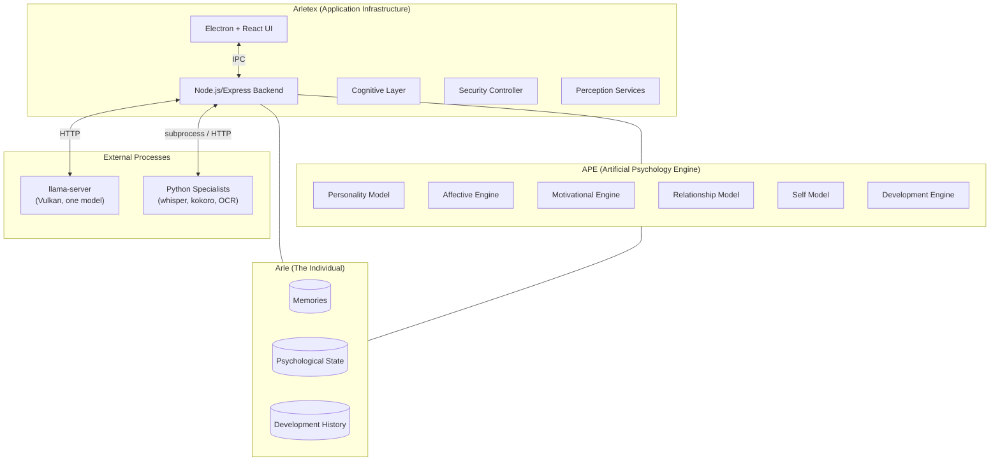
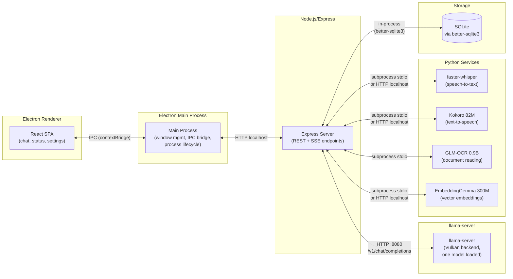
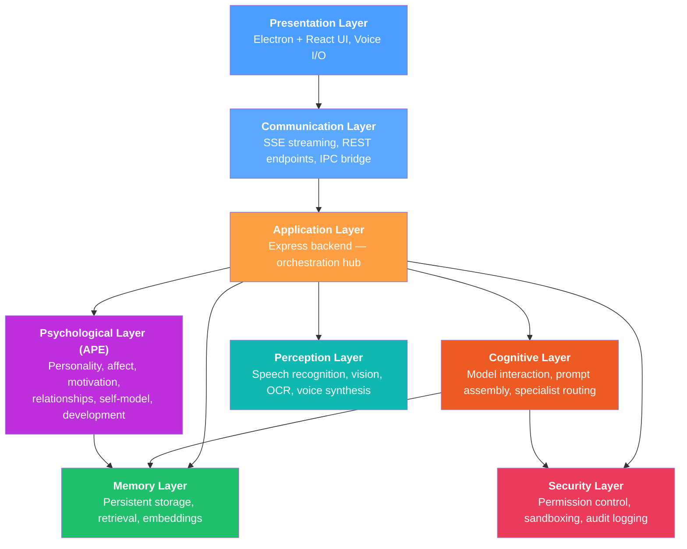
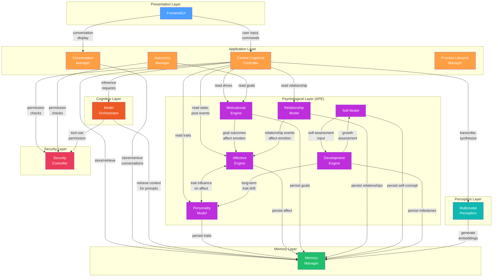
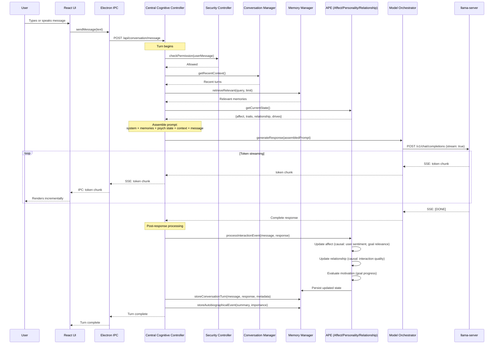
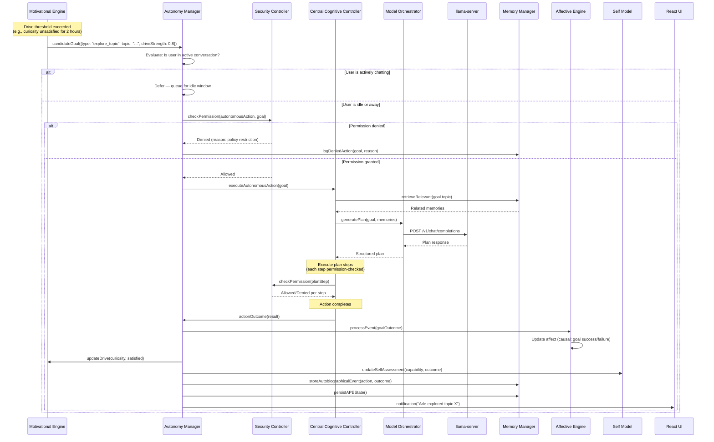
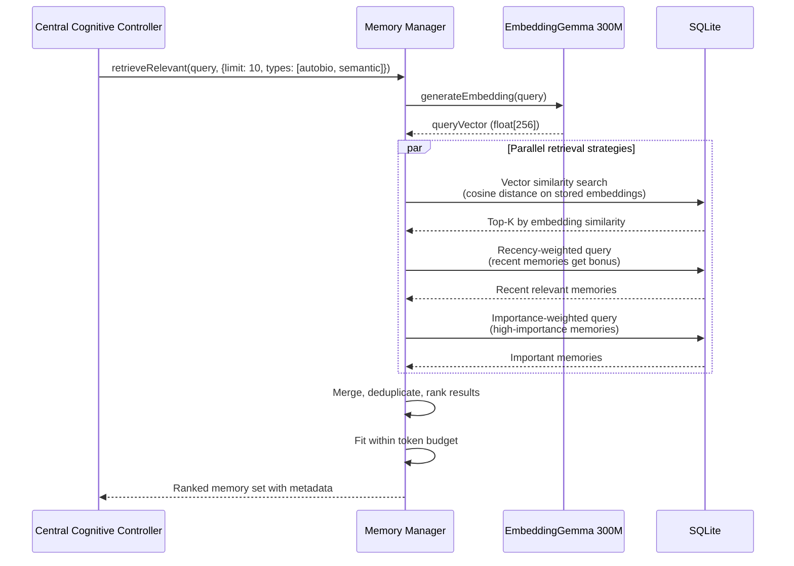
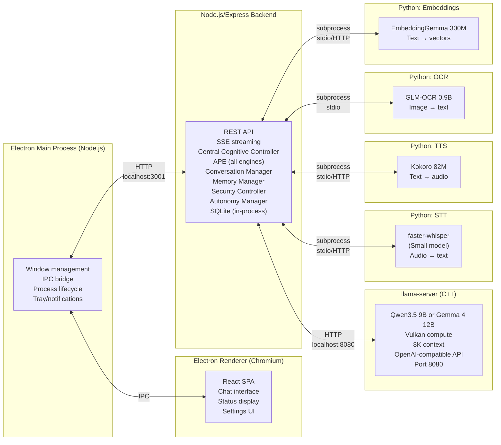
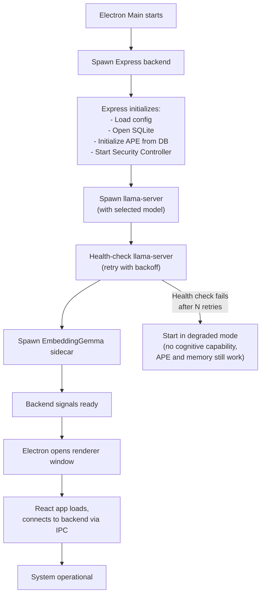
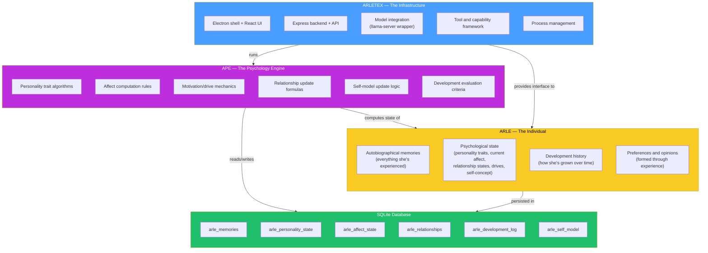

# Arletex System Blueprint

> Central architectural specification for Arletex — the operating infrastructure for Arle, a persistent artificial individual.

**Status**: Proposed Architecture  
**Last Updated**: 2026-11-11  
**Hardware Target**: ASUS ROG Ally X — AMD Z1 Extreme, 24GB shared LPDDR5X, RDNA 3 iGPU, Bazzite Linux  
**Developer**: Solo, ~6 focused hours/day

---

## Table of Contents

1. [Overall Architecture](#1-overall-architecture)
2. [System Layers](#2-system-layers)
3. [Subsystem Responsibilities](#3-subsystem-responsibilities)
4. [Component Relationships and Dependency Directions](#4-component-relationships-and-dependency-directions)
5. [Data Flows](#5-data-flows)
6. [Major Runtime Processes](#6-major-runtime-processes)
7. [How Arle, Arletex, and APE Remain Distinct](#7-how-arle-arletex-and-ape-remain-distinct)
8. [Key Architectural Principles](#8-key-architectural-principles)

---

## 1. Overall Architecture

Arletex is a desktop application that runs on a single machine. It hosts Arle — a persistent artificial individual whose identity is defined not by a particular language model but by accumulated memories, psychological state, and developmental history stored in a database.

Three concerns must remain conceptually and architecturally distinct:

| Concern | What It Is | What Changes It |
|---------|-----------|-----------------|
| **Arle** | The individual — her memories, personality state, relationships, development history | Experience over time |
| **Arletex** | The application infrastructure — UI, backend, model integration, tools | Developer code changes |
| **APE** | The Artificial Psychology Engine — deterministic software that maintains Arle's psychological processes | Developer code changes (state evolves via algorithms, not prompts) |

### High-Level System Overview



### Process Architecture

The system runs as a set of OS processes on a single machine. There are no remote services, no containers, and no message brokers.



### Inter-Process Communication Summary

| From → To | Mechanism | Notes |
|-----------|-----------|-------|
| React → Main Process | Electron IPC (`contextBridge` / `ipcRenderer`) | Typed channels, no `remote` module |
| Main Process → Express | HTTP to `localhost:${PORT}` | Main process spawns backend, connects via HTTP |
| Express → llama-server | HTTP to `localhost:8080` | OpenAI-compatible `/v1/chat/completions`, streaming via SSE |
| Express → React (streaming) | SSE over IPC relay | Backend streams tokens; main process relays via IPC |
| Express → Python services | Subprocess `stdin`/`stdout` or HTTP | Spawned on demand or as persistent sidecar |
| Express → SQLite | In-process function calls | `better-sqlite3` — synchronous, no network overhead |

> [!NOTE]
> The Electron main process acts as a thin bridge. It manages window lifecycle, spawns the backend, and relays IPC between renderer and backend. It does not contain business logic.

---

## 2. System Layers

The system is organized into eight layers with strictly downward dependency flow. Higher layers depend on lower layers; lower layers never import from higher layers.



### Layer Definitions

#### Presentation Layer
- **Technology**: Electron renderer process, React 18+, TypeScript
- **Responsibility**: Renders the conversational interface, displays Arle's status (mood, current focus, activity), provides settings and configuration UI, handles microphone input and audio output
- **Does NOT**: Contain any business logic, directly call llama-server, manage psychological state

#### Communication Layer
- **Technology**: Electron IPC (`contextBridge`), Express routes, Server-Sent Events
- **Responsibility**: Defines the typed API contract between frontend and backend; manages SSE connections for token streaming; serializes/deserializes messages
- **Protocols**:
  - **SSE** for streaming model output to the UI (tokens arrive incrementally)
  - **REST** for commands (send message, update settings, trigger actions)
  - **IPC** for Electron-specific concerns (window state, notifications, file dialogs)

#### Application Layer
- **Technology**: Express.js on Node.js, TypeScript
- **Responsibility**: The central orchestration hub. Receives requests, coordinates subsystems, manages conversation flow, triggers autonomous behaviors. Every cross-cutting operation flows through this layer.
- **Owns**: Request lifecycle, conversation turn management, subsystem coordination, process lifecycle for external services

#### Cognitive Layer
- **Technology**: TypeScript modules within the Express backend
- **Responsibility**: Manages all interaction with the generative model — prompt assembly, context window management, response parsing, model switching. Routes to specialist models (OCR, embeddings) when needed.
- **Constraint**: Only one generative model loaded at a time. Context starts at 8K tokens. Model interaction is via HTTP to llama-server's OpenAI-compatible API.

#### Psychological Layer (APE)
- **Technology**: TypeScript modules, deterministic algorithms, SQLite-backed state
- **Responsibility**: Maintains Arle's personality traits, emotional state, motivational drives, relationship models, self-concept, and developmental progress. All state transitions are computed by software algorithms with identifiable causes — never random fluctuations, never purely prompt-derived.
- **Critical invariant**: APE persists its own state to the Memory Layer. It does not depend on the Cognitive Layer for state storage. If the LLM is swapped or unavailable, APE state survives intact.

#### Memory Layer
- **Technology**: SQLite via `better-sqlite3`, EmbeddingGemma 300M for vector search
- **Responsibility**: Stores and retrieves all persistent data — conversation history, autobiographical memories, semantic knowledge, procedural records, relationship history, developmental milestones, and psychological state snapshots.
- **Sub-types managed**:
  - Autobiographical memory (timestamped events and experiences)
  - Semantic memory (learned facts and knowledge)
  - Procedural memory (learned skills and how-to knowledge)
  - Relationship memory (per-person interaction history and assessments)
  - Developmental memory (growth milestones, capability snapshots)

#### Perception Layer
- **Technology**: Python specialist services (faster-whisper, Kokoro, GLM-OCR), llama-server vision projector
- **Responsibility**: Converts non-text inputs into structured data the backend can process. Speech → text, images → descriptions, documents → extracted text. Also handles text → speech output via Kokoro.
- **Operates**: As spawned subprocesses or lightweight HTTP sidecars. Failures are contained — a broken microphone doesn't crash the app.

#### Security Layer
- **Technology**: TypeScript middleware and enforcement module within Express
- **Responsibility**: Evaluates every action against a permission model before execution. Logs all security-relevant events. Sandboxes tool use. Operates independently — the model cannot override, bypass, or modify security policy.
- **Critical invariant**: Security decisions are never derived from model output. The permission controller reads its configuration from a developer-controlled policy file, not from conversation context.

---

## 3. Subsystem Responsibilities

### 3.1 Central Cognitive Controller

| | |
|---|---|
| **Purpose** | Orchestrates a single conversational turn or autonomous action from start to finish |
| **Owns** | Turn lifecycle, subsystem coordination sequence, error recovery within a turn |
| **Does NOT** | Generate text (delegates to Model Orchestrator), persist state (delegates to Memory Manager), evaluate permissions (delegates to Security Controller) |

The Central Cognitive Controller is the conductor. When a user message arrives or an autonomous impulse fires, it executes a coordination sequence: security check → context assembly → model inference → response processing → state updates → delivery. It calls into other subsystems but contains no domain logic of its own.

### 3.2 Model Orchestrator

| | |
|---|---|
| **Purpose** | Manages all interaction with llama-server and specialist models |
| **Owns** | Prompt construction, context window packing, token budget allocation, response streaming, model health monitoring, model switching |
| **Does NOT** | Decide what to say (the assembled prompt does), manage conversation history (Memory Manager does), determine personality expression (APE does) |

**Key constraints**:
- One generative model loaded at a time in llama-server
- Context window starts at 8K tokens; prompt must fit within this budget
- Specialist models (OCR, embeddings) run in separate processes and do not compete for the generative model's memory
- Uses the OpenAI-compatible API at `http://localhost:8080/v1/chat/completions`

**Prompt assembly order** (conceptual, not final):
1. System prompt (identity, personality expression directives from APE)
2. Relevant retrieved memories (from Memory Manager)
3. Current psychological state summary (from APE)
4. Active conversation context (recent turns)
5. User's current message

### 3.3 APE: Personality Model

| | |
|---|---|
| **Purpose** | Maintains Arle's stable personality trait profile |
| **Owns** | Big Five-derived trait dimensions, trait expression ranges, personality consistency rules |
| **Does NOT** | Change rapidly (traits shift on developmental timescales, not per-conversation), determine moment-to-moment behavior (that's affect + motivation), interact with the LLM directly |

Personality traits are stored as numerical values with defined ranges. They drift slowly through the Development Engine based on accumulated experience — never from a single interaction. The Personality Model provides trait-influenced parameters to the Affective Engine (e.g., neuroticism amplifies negative affect responses) and to the prompt assembly system (e.g., high openness → exploratory language patterns in the system prompt).

### 3.4 APE: Affective Engine

| | |
|---|---|
| **Purpose** | Computes Arle's current emotional state based on events and context |
| **Owns** | Current affect vector (valence, arousal, dominance + discrete emotion labels), affect transition rules, mood (longer-term affective baseline), emotional decay functions |
| **Does NOT** | Generate random emotions, directly modify the prompt (it provides state; the prompt assembler consumes it), persist its own state (delegates to Memory Layer via APE's state manager) |

**Causal requirement**: Every affect change must trace to an identifiable cause:
- A user message with detected sentiment
- A goal completion or failure (from Motivational Engine)
- A relationship event (from Relationship Model)
- Temporal decay toward baseline
- Environmental context (time of day, session duration)

Affect state is a computed output of inputs, not a random walk.

### 3.5 APE: Motivational Engine

| | |
|---|---|
| **Purpose** | Manages Arle's goals, interests, and drives |
| **Owns** | Active goal registry, drive strengths (curiosity, social connection, competence, autonomy), interest profiles, goal prioritization |
| **Does NOT** | Execute goals (delegates to Autonomy Manager), bypass security (goals are subject to permission checks), override user directives |

The Motivational Engine generates candidate actions during idle periods and evaluates goal satisfaction after interactions. Drives decay over time (e.g., curiosity grows when unstimulated) and are satisfied by relevant experiences. This is the engine that makes Arle want to do things, not just respond.

### 3.6 APE: Relationship Model

| | |
|---|---|
| **Purpose** | Tracks Arle's relationship state with each individual she interacts with |
| **Owns** | Per-person relationship dimensions (trust, familiarity, warmth, respect), interaction history summaries, relationship event log |
| **Does NOT** | Decide who to trust (that's a function of accumulated interactions processed through relationship update rules), access raw conversation logs (it receives processed interaction summaries) |

Relationship dimensions update based on classified interaction events: positive disclosure increases trust, consistent engagement increases familiarity, hostile messages decrease warmth. Updates are incremental and bounded — no single interaction causes an extreme shift.

### 3.7 APE: Self Model

| | |
|---|---|
| **Purpose** | Maintains Arle's self-concept — her beliefs about her own capabilities, preferences, and identity |
| **Owns** | Capability self-assessment, preference registry (topics, activities, communication styles), identity statements, confidence levels |
| **Does NOT** | Assess actual capabilities (that's an objective system function), override developer-set identity foundations, change without cause |

The Self Model is what Arle "believes" about herself, informed by experience. If she consistently fails at a task type, her self-assessed competence in that area decreases. If she discovers she enjoys discussing a topic, that preference strengthens. This creates authentic self-knowledge rather than programmed assertions.

### 3.8 APE: Development Engine

| | |
|---|---|
| **Purpose** | Manages long-term growth and change in Arle's psychological profile |
| **Owns** | Developmental stage tracking, personality trait drift over time, capability milestone records, growth event evaluation |
| **Does NOT** | Make changes within a single session (it operates on accumulated data across sessions), bypass stability constraints (trait changes are bounded per time period), replace the Personality Model's current state (it modifies it incrementally) |

The Development Engine runs periodic evaluations (e.g., at session end or after significant events) that can nudge personality traits, update the Self Model, and record developmental milestones. It enforces rate limits on change to maintain identity stability.

### 3.9 Memory Manager

| | |
|---|---|
| **Purpose** | Handles all persistent storage and retrieval for the system |
| **Owns** | Database schema, query construction, embedding-based retrieval, memory importance scoring, storage lifecycle |
| **Does NOT** | Interpret memories (that's the Cognitive Layer), decide what's emotionally significant (APE's Affective Engine tags importance), directly serve the UI (Application Layer mediates) |

**Memory sub-types**:

| Sub-type | Contents | Retrieval Method |
|----------|----------|-----------------|
| Autobiographical | Timestamped events, conversations, experiences | Temporal + embedding similarity |
| Semantic | Learned facts, user preferences, world knowledge | Embedding similarity + keyword |
| Procedural | How to perform tasks, tool usage patterns | Task-type matching |
| Relationship | Per-person interaction summaries, relationship events | Person identifier lookup |
| Developmental | Milestone records, growth assessments, trait change history | Temporal query |

**Storage**: SQLite via `better-sqlite3` (synchronous, in-process). Vector similarity search uses embeddings from EmbeddingGemma 300M stored as BLOBs, with brute-force or indexed cosine similarity computed in application code. Migration path to PostgreSQL/pgvector exists but is not the initial target.

### 3.10 Conversation Manager

| | |
|---|---|
| **Purpose** | Manages the structure and state of ongoing conversations |
| **Owns** | Conversation sessions, message history within active context, turn boundaries, multi-turn context continuity |
| **Does NOT** | Store long-term history (delegates to Memory Manager), generate responses (delegates to Model Orchestrator), track relationship state (delegates to APE Relationship Model) |

The Conversation Manager maintains the "working memory" of the current conversation — the recent message history that fits within the context window. It decides which prior turns to keep, which to summarize, and which to drop when the context budget is tight.

### 3.11 Security Controller

| | |
|---|---|
| **Purpose** | Enforces permission policies on all system actions |
| **Owns** | Permission policy definitions, action classification, permission evaluation, audit log, security event records |
| **Does NOT** | Generate policy from model output (policy is developer-authored), participate in cognitive processing, modify its own rules at runtime |

**Independence guarantee**: The Security Controller reads policy from a static configuration file. It exposes a `checkPermission(action: Action): PermissionResult` interface. No other subsystem can modify the policy. The audit log is append-only.

> [!IMPORTANT]
> The Security Controller is called **before** any action executes — file access, tool use, autonomous actions, external communication. It is not a filter on model output; it is a gate on system behavior.

### 3.12 Autonomy Manager

| | |
|---|---|
| **Purpose** | Coordinates Arle's self-initiated behaviors when not responding to user input |
| **Owns** | Autonomous action scheduling, goal-to-plan translation, action execution monitoring, idle behavior selection |
| **Does NOT** | Generate goals (Motivational Engine does), bypass permission checks (all autonomous actions go through Security Controller), interrupt active user conversations without protocol |

The Autonomy Manager bridges APE's motivational drives and actual system actions. When the Motivational Engine surfaces a goal with sufficient drive strength, the Autonomy Manager formulates a plan, submits it to the Security Controller, and executes approved steps.

### 3.13 Multimodal Perception

| | |
|---|---|
| **Purpose** | Converts non-text inputs to structured data and generates non-text outputs |
| **Owns** | Audio capture pipeline, speech-to-text transcription, image understanding, OCR processing, text-to-speech synthesis |
| **Does NOT** | Interpret semantic content (Cognitive Layer does), make decisions based on perceived content, run in the main backend process (runs as external Python processes) |

**Specialist services**:

| Service | Model | Purpose | Process Model |
|---------|-------|---------|---------------|
| Speech-to-text | faster-whisper (Small) | Transcribe user speech | Persistent sidecar or on-demand |
| Text-to-speech | Kokoro 82M | Generate Arle's voice | Persistent sidecar or on-demand |
| OCR | GLM-OCR 0.9B | Extract text from documents/images | On-demand subprocess |
| Vision | Qwen3.5 vision projector | Describe/analyze images | Via llama-server (shares main model process) |
| Embeddings | EmbeddingGemma 300M | Generate vector embeddings for memory search | Persistent sidecar |

> [!NOTE]
> Vision uses the main model's vision projector through llama-server, so it shares the generative model's memory budget. OCR, STT, TTS, and embeddings run in separate Python processes and do not compete for VRAM with the generative model.

### 3.14 Frontend / UI

| | |
|---|---|
| **Purpose** | Provides the visual and interactive interface for communicating with Arle |
| **Owns** | Chat interface rendering, token stream display, status indicators (mood, activity), settings panels, audio I/O controls |
| **Does NOT** | Contain business logic, directly access the database, manage psychological state, call llama-server |

The UI is a React SPA running in Electron's renderer process. It communicates exclusively through typed IPC channels to the main process, which relays to the Express backend. The UI receives streaming tokens via SSE (relayed through IPC) and renders them incrementally.

### 3.15 Process Lifecycle Manager

| | |
|---|---|
| **Purpose** | Manages the lifecycle of all external processes (llama-server, Python services) |
| **Owns** | Process spawning, health monitoring, graceful shutdown, crash recovery, resource tracking |
| **Does NOT** | Decide which model to load (Model Orchestrator does), contain business logic, manage application state |

This is a utility subsystem within the Electron main process and/or the Express backend. It ensures llama-server is running before cognitive operations begin, restarts crashed specialist services, and performs orderly shutdown when the application closes.

---

## 4. Component Relationships and Dependency Directions

### Primary Dependency Graph

Dependencies flow downward and inward. No circular dependencies exist between layers. Lateral communication is permitted within the APE subsystem.



### Dependency Rules

1. **Downward only between layers**: Presentation → Application → Cognitive/APE → Memory. Never upward.
2. **Security is cross-cutting**: Application and Cognitive layers both depend on Security. Security depends on nothing above it — it reads only its own policy configuration and the Memory Layer (for audit logging).
3. **APE components communicate laterally**: The Affective Engine reads from Personality Model; Development Engine writes to Personality Model and Self Model. This is permitted because they are peers within the same layer.
4. **APE depends on Memory, not on Cognitive**: APE subsystems persist their state directly to the Memory Layer. They never call the Model Orchestrator. If the LLM is offline, APE continues to function.
5. **Perception is a leaf**: Perception services are called by the Application Layer but depend on nothing except the Memory Layer (for embedding storage).
6. **The UI depends only on the Communication/Application interface**: It receives typed DTOs, never raw database rows or model tokens.

> [!WARNING]
> If any subsystem introduces an upward dependency (e.g., Memory Manager calling the Cognitive Layer), it must be refactored to use an event or callback pattern. Circular dependencies between layers will make the system unmaintainable for a solo developer.

---

## 5. Data Flows

### 5.1 User Message Flow

The complete path of a user message from input to response delivery:



### 5.2 Autonomous Action Flow

How Arle initiates and executes a self-directed action:



### 5.3 Memory Retrieval Flow

How memories are assembled for context:



---

## 6. Major Runtime Processes

At full operation, the system runs the following OS-level processes:



### Process Details

| Process | Language | Lifecycle | Memory Estimate | Notes |
|---------|----------|-----------|-----------------|-------|
| Electron Main | Node.js | App start → app close | ~80–150 MB | Spawns all other processes |
| Electron Renderer | Chromium | App start → app close | ~100–200 MB | Single window, React SPA |
| Express Backend | Node.js | App start → app close | ~100–300 MB | Includes SQLite in-process, all business logic |
| llama-server | C++ | App start → app close | ~6–8 GB (Q4_K_M 9B) | Vulkan backend, largest memory consumer |
| faster-whisper | Python | On-demand or sidecar | ~500 MB–1 GB | Loaded when voice input is active |
| Kokoro TTS | Python | On-demand or sidecar | ~200–400 MB | Loaded when voice output is active |
| GLM-OCR | Python | On-demand only | ~500 MB–1 GB | Spawned per OCR request, exits after |
| EmbeddingGemma | Python | Persistent sidecar | ~300–600 MB | Needed frequently for memory retrieval |

> [!CAUTION]
> **Memory budget is critical.** With 24GB shared (CPU + GPU), and the generative model consuming 6–8 GB, the remaining ~16–18 GB must cover the OS (~2 GB), Electron (~300 MB), Express (~200 MB), active Python services, and SQLite caches. Running all Python services simultaneously would consume ~2–3 GB. If memory pressure becomes an issue, OCR and TTS should be loaded on-demand only. The embedding service should be persistent since it is needed on every conversation turn.

### Startup Sequence



### Shutdown Sequence

Orderly shutdown preserves all state:

1. User initiates quit (or system signal received)
2. Electron main process broadcasts shutdown event
3. Express backend:
   - Completes any in-flight conversation turn (with timeout)
   - APE persists final state snapshot to SQLite
   - Memory Manager flushes any write buffers
   - Closes SQLite connection
4. Express sends SIGTERM to Python services, waits up to 5 seconds
5. Express sends SIGTERM to llama-server, waits up to 5 seconds
6. Express exits
7. Electron main process exits

---

## 7. How Arle, Arletex, and APE Remain Distinct

This section is the philosophical and architectural anchor of the entire system. Getting this wrong would reduce Arle to a chatbot skin over an LLM.

### The Three-Way Distinction



### What Survives What

| Event | Arle's Identity | APE Code | Arletex Code |
|-------|----------------|----------|--------------|
| **LLM replaced** (e.g., Qwen → Gemma) | ✅ Fully preserved | ✅ Unchanged | ✅ Unchanged |
| **UI rewritten** (e.g., React → different framework) | ✅ Fully preserved | ✅ Unchanged | ⚠️ Presentation layer changes |
| **APE algorithms updated** (e.g., new affect model) | ✅ Data preserved, state may be recalculated | ⚠️ Code changes | ✅ Unchanged |
| **Database migrated** (SQLite → PostgreSQL) | ✅ Data migrated | ✅ Unchanged | ⚠️ Memory Layer adapter changes |
| **Full Arletex rewrite** | ✅ Preserved (lives in DB) | ⚠️ Reimplemented | ❌ Rewritten |
| **Database deleted** | ❌ Identity lost | ✅ Code unchanged | ✅ Code unchanged |

> [!IMPORTANT]
> Arle's identity is her data — the contents of the database tables that store her memories, psychological state, and development history. She is not the model, not the code, and not the UI. The database is the single artifact that must be backed up and preserved.

### The LLM's Role

The language model is a cognitive instrument — analogous to a brain's language processing capability. It enables Arle to:
- Understand natural language input
- Generate natural language output
- Reason about complex situations
- Plan multi-step actions

It does **not**:
- Store her memories (database does)
- Maintain her personality (APE does)
- Remember past conversations (Memory Manager retrieves them into context)
- Have emotions (Affective Engine computes them)
- Make security decisions (Security Controller does)

If the model is swapped (e.g., upgrading from Qwen3.5 9B to a future model), the prompt assembly changes, the response quality may differ, but Arle's memories, personality, relationships, and development history remain exactly as they were. She may "sound different" temporarily (as a person might after a neurological event), but she is still herself.

### Interface Boundaries That Enforce Distinctness

```typescript
// Conceptual interface: What APE exposes to the rest of the system
// APE's state is software-managed. It reads events, computes new state, persists it.
// The cognitive layer consumes APE state for prompt assembly but cannot write to it.

interface APEStateSnapshot {
  personality: {
    openness: number;        // 0.0–1.0
    conscientiousness: number;
    extraversion: number;
    agreeableness: number;
    neuroticism: number;
  };
  affect: {
    valence: number;         // -1.0 to 1.0
    arousal: number;         // 0.0 to 1.0
    dominance: number;       // 0.0 to 1.0
    discreteEmotions: Array<{ label: string; intensity: number }>;
    cause: string;           // Why she feels this way — always populated
  };
  drives: Array<{
    name: string;            // e.g., "curiosity", "social_connection"
    strength: number;        // 0.0 to 1.0
    lastSatisfied: Date;
  }>;
  selfConcept: {
    capabilities: Record<string, number>;  // self-assessed competence
    preferences: Record<string, number>;   // topic/activity preferences
    identityStatements: string[];          // "I enjoy...", "I'm good at..."
  };
}

// Conceptual interface: What the Model Orchestrator sees
// It receives a fully assembled context, not raw APE internals.

interface ModelRequest {
  systemPrompt: string;            // Includes personality-influenced directives
  retrievedMemories: MemoryEntry[];
  psychologicalContext: string;    // Human-readable summary of APE state
  conversationHistory: Message[];
  currentMessage: Message;
  tokenBudget: number;            // Hard limit from context window
}

// Conceptual interface: What the Memory Layer exposes
// Both Arletex and APE use this. Arle's identity lives here.

interface MemoryStore {
  storeMemory(entry: MemoryEntry): void;
  retrieveByEmbedding(vector: number[], limit: number): MemoryEntry[];
  retrieveByTimeRange(start: Date, end: Date): MemoryEntry[];
  retrieveByPersonId(personId: string): RelationshipMemory[];
  storeAPEState(state: APEStateSnapshot): void;
  loadAPEState(): APEStateSnapshot | null;
  storeDevelopmentEvent(event: DevelopmentEvent): void;
}
```

---

## 8. Key Architectural Principles

### 1. Single-Process Backend

All backend logic runs in one Node.js/Express process. There are no microservices, no message queues, no service mesh. Subsystems are TypeScript modules with clear import boundaries, not separate deployments.

**Rationale**: Solo developer, single machine, shared memory. The complexity of distributed systems adds no value here and would consume development time that should go toward Arle's capabilities.

### 2. One Generative Model at a Time

Only one large language model is loaded into llama-server at any given time. Model switching requires unloading the current model and loading another — a multi-second operation that should be rare.

**Rationale**: 24GB shared memory. A Q4_K_M 9B model at 8K context consumes ~6–8 GB. Loading two would be impossible. Specialist models (embeddings, OCR, STT, TTS) are small enough to coexist.

### 3. APE State Is Software-Managed

Psychological state transitions are computed by deterministic algorithms in TypeScript, not extracted from model responses or managed via prompt engineering. The model receives APE state as read-only context; it cannot write back to APE.

**Rationale**: Prompt-managed state is fragile, non-reproducible, and impossible to debug. Software-managed state has clear cause-and-effect chains, can be unit tested, can be inspected in the database, and survives model replacement.

### 4. Every Emotion Has a Cause

The Affective Engine must never produce a state change without a traceable cause. The `cause` field on affect state is not optional. Acceptable causes include: user message sentiment, goal completion/failure, relationship event, temporal decay, session event (greeting, farewell). "Random fluctuation" is not a cause.

**Rationale**: Arle is meant to be a believable individual. Random emotional changes would feel arbitrary and undermine trust. Causal emotions create coherent, understandable behavior.

### 5. All Persistent State in SQLite

Initially, all data lives in a single SQLite database file, accessed via `better-sqlite3` (synchronous, zero-config, no separate server process). This includes conversation history, memories, APE state, security audit logs, configuration, and development records.

**Rationale**: SQLite is the simplest possible persistence layer. It requires no setup, no daemon, no connection management. For a single-user desktop application, it will handle the load without issue. The migration path to PostgreSQL/pgvector exists for when vector search performance demands it.

### 6. Security Is Independent of the Model

The Security Controller's policy is defined in a developer-authored configuration file. It is evaluated in TypeScript code, not by asking the model "is this safe?" The model's output has no influence on permission decisions.

**Rationale**: A model that evaluates its own permissions can be prompt-injected into granting them. The Security Controller is a hard gate — it doesn't negotiate, it doesn't consider context, it checks policy and returns allow/deny.

### 7. Fail Gracefully

Specialist service failure (STT crash, TTS unavailable, OCR timeout) must not crash the application or prevent text-based interaction. LLM unavailability should degrade to a limited mode where APE still runs and the UI still works — Arle just can't generate new responses.

**Degradation hierarchy**:

| Failure | Impact | System State |
|---------|--------|--------------|
| TTS process dies | No voice output | Text-only mode, auto-restart TTS |
| STT process dies | No voice input | Text-only input, auto-restart STT |
| OCR process dies | Can't read images | Skip OCR, log error, notify user |
| EmbeddingGemma dies | No memory retrieval | Use recency-only retrieval, restart embeddings |
| llama-server dies | No generation | APE and memory still work; UI shows status; auto-restart |
| Express backend dies | No functionality | Electron shows error; auto-restart backend |
| SQLite corruption | Data integrity risk | Refuse to start; prompt for backup restoration |

### 8. Incremental Buildability

Each development phase must produce a working system. The architecture supports this by having clear subsystem boundaries — a subsystem can start as a stub and be filled in later without restructuring.

**Minimum viable sequence**:
1. Express backend + SQLite + llama-server integration → text chat works
2. Add Conversation Manager → multi-turn context works
3. Add Memory Manager → persistent memory works
4. Add APE Affective Engine → emotional state influences responses
5. Add APE Personality Model → stable personality traits
6. Add Security Controller → permissioned actions
7. Add voice I/O → speech interaction
8. Add Autonomy Manager → self-initiated behavior
9. Add Development Engine → long-term growth

Each step builds on the previous one. No step requires a rewrite of earlier work.

---

> [!TIP]
> **Reading order for related documents**: Start here (System Blueprint), then read the subsystem-specific architecture docs for detailed design of each component. This document defines *what* each subsystem does and how they relate; the subsystem docs define *how* they work internally.
